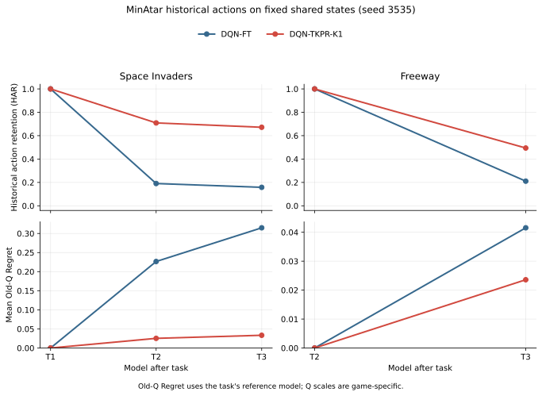

# MinAtar 历史动作保持分析：seed 3535 的前三个任务

## 范围与模型

使用已完成的 [DQN-FT / DQN-TKPR-K1 实验](../../comparisons/minatar-single-agent-tkpr-3535/README.md)中首次训练 Space Invaders、Freeway、Breakout 后的六个 `stage_0/1/2_checkpoint.pt`，对应累计 0.5M、1.0M、1.5M 环境步。原训练源码为 [`80d7ad6`](https://github.com/wangyahao6/marl_method_lab/commit/80d7ad68abf7b9069e54721d668a233a9de0f7f6)；[清单](manifest.json)记录每个检查点的阶段、任务、步数及 SHA-256。本分析没有重新训练，也没有使用 1.5M 步之后的回访检查点。

原实验的评价文件只有回报汇总，没有观测轨迹。我们沿用原阶段末贪心评价的种子块和每游戏 20 局协议，分别用 FT 和 K1 在该游戏首次完成时的冻结 online 网络独立采集轨迹，再合并为该游戏的一个固定观测数组。两个方法在**同一个数组**上计算指标，后续检查点不再生成状态。观测仍由原 MinAtar 包装器补零至 `[7,10,10]`，使用 `v0` 六动作映射；网络置于 `eval` 模式并关闭探索。采集时每个来源的平均回报与原记录一致。

| 固定状态集 | 来源 | 访问状态 | 唯一状态 | 用于比较 |
| --- | --- | ---: | ---: | --- |
| Space Invaders | FT 与 K1 各 20 局、各 7,847 次访问 | 15,694 | 6,906 | T1→T2、T1→T3 |
| Freeway | FT 与 K1 各 20 局、各 50,020 次访问 | 100,040 | 58,611 | T2→T3 |
| Breakout | FT 1,754、K1 2,880 次访问 | 4,634 | 1,270 | 留存供复用；前三任务内无后续阶段 |

固定观测、来源方法代码、评价局种子和局内步号保存在 [`states/*.npz`](states/)；重复访问保留，指标按状态访问次数加权。T1 的两个参考检查点 SHA-256 相同，因此合并的两份 Space Invaders 轨迹也相同；这不构成 40 条独立轨迹。数据集独立于 TD Replay Buffer 和 TKPR 历史偏好记忆。

## 指标与结果

对任务 $k$ 的固定状态集 $\mathcal D_k$，以该任务结束时的 online Q 网络作为**各方法自己的**参考模型。历史动作保持率 `HAR` 是参考模型与阶段 $t$ 模型的贪心动作相同的比例；动作变化率 `ADR = 1 − HAR`。两模型的动作均由同一个 `[7,10,10]` 观测推理，平局动作沿 PyTorch/NumPy 的首个最大值规则。

`Old-Q Regret(s) = Q_{θ_k}(s, a_{θ_k}(s)) − Q_{θ_k}(s, a_{θ_t}(s))`。两个动作**都由旧模型的 online Q** 评价，值非负。此量是旧模型视角下的动作价值损失，并非实测环境回报损失，也不是新旧 Q 值的直接相减。原始 Q 尺度随游戏和参考模型变化，下表不跨游戏比较损失绝对值；Freeway 两方法的参考模型也不同。

| 历史任务 | 比较 | FT HAR / ADR | K1 HAR / ADR | FT Old-Q Regret 均值 / 中位数 | K1 Old-Q Regret 均值 / 中位数 | FT / K1 旧任务平均回报 |
| --- | --- | ---: | ---: | ---: | ---: | ---: |
| Space Invaders | T1→T2 | 19.05% / 80.95% | 70.91% / 29.09% | 0.22656 / 0.13768 | 0.02531 / 0 | 0 / 37.35 |
| Space Invaders | T1→T3 | 15.79% / 84.21% | 67.18% / 32.82% | 0.31482 / 0.20995 | 0.03334 / 0 | 0 / 34.70 |
| Freeway | T2→T3 | 21.08% / 78.92% | 49.43% / 50.57% | 0.04155 / 0.03196 | 0.02360 / 0.00057 | 0.15 / 17.80 |

回报是原实验中每游戏 20 局的阶段末贪心评价，不是固定状态上的离线估计。[历史动作指标](action_retention.csv)包含参考点、各分位数、零损失比例和状态数；[逐状态文件](pointwise/)保留参考动作、后续动作、旧 Q 对两动作的值及每状态损失，可复核完整分布。[方法对比](method_comparison.csv)把 HAR、Old-Q Regret 与同期回报列在同一行；[阶段性能](historical_performance.csv)包含已学任务的所有原始阶段末平均回报。Breakout 在此范围内没有后续阶段，因此不报告它的遗忘率。



## 解读与限制

本次前三阶段中，Space Invaders 的两方法参考模型完全相同；其后 K1 的 HAR 明显高于 FT，旧模型视角损失较低，同时原有贪心回报也较高。Freeway 在 T2 学完时 K1 的平均回报为 12.30，低于 FT 的 26.30；到 T3 末 K1 保持 17.80、FT 降至 0.15，同时 K1 的 HAR 较高。这些是同一批数据中的**伴随现象**，不能单凭相关性证明动作保持导致回报差异。

状态集来自参考策略访问分布，重复访问会给常见状态更高权重；后续策略若访问不同状态，HAR 无法直接预测其实测回报。Old-Q Regret 依赖旧模型估值，可能与真实动作回报排序不一致。两方法只有一个训练种子，虽共享任务顺序、评价种子和固定状态集，T1 后仍是不同训练轨迹；不进行显著性检验或普遍性推断。全 3.5M 步的最终结果另见原[实验报告](../../comparisons/minatar-single-agent-tkpr-3535/README.md)，本页不使用那些回访阶段作历史保持计算。

## 复算

在保留原运行目录和依赖的实验主机上，从仓库根目录执行：

```sh
PYTHONPATH=src:.:/home/wyh/venvs/minatar_tkpr_deps:/home/wyh/venvs/mountaincar_tkpr_deps \
  /home/wyh/marl_method_lab/.venv/bin/python scripts/analyze_minatar_har.py \
  --ft-run runs/minatar_ft_tkpr_k1_seed3535_20261122_ft_attempt001 \
  --tkpr-run runs/minatar_ft_tkpr_k1_seed3535_20261122_tkpr_k1_attempt001 \
  --output analysis/<new-run-id> --device cuda
```

图可在装有 Matplotlib 的环境中用 `python scripts/plot_minatar_har.py --metrics <output>/action_retention.csv --output <output>/har_regret_curves.svg` 生成。原检查点、评价日志与完整训练产物仍在主机 `/home/wyh/marl_method_lab_minatar/runs/`；本目录只增加离线分析产物，不改写它们。
