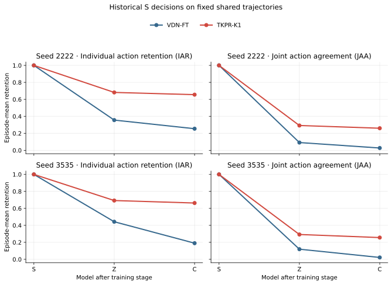

# SZC 共享前缀：S 历史联合动作保持

## 范围和证据

复用[VDN64 共享 S 前缀实验](../../comparisons/szc-vdn64-tkpr-k1-shared/README.md)，仅分析 seed 2222、3535 的 VDN-FT 和 TKPR-K1。任务为 S（stalker）→ Z（zealot）→ C（colossus），各阶段约 2M 环境步。每个 seed 下两方法使用同一个 S 阶段模型；比较该模型与各方法 Z、C 阶段结束模型在 **S 轨迹**上的动作。没有重新训练，也没有使用之后的回访模型。

[清单](manifest.json)从原实验 `runs.csv`、各运行的 `retention.json` 和 `models/` 定位检查点，记录训练源码 commit `2c761c44b3aa2ab4dda68f71ec9b7dccbdb86818`、运行 ID、实际累计步数和各 `agent.th` 的 SHA-256。FT/K1 分支的 `parent_run_id`、`branch_restore.json` 的父目录、恢复检查点和模型哈希均与对应 S 前缀匹配。原始训练结果及配置未改动。

## 独立历史轨迹和离线推理

每个 seed 用自己的共享 S 检查点，在 S 环境进行 32 局完整贪婪评估。分析环境种子分别为 `1502222`、`1503535`，与原训练、评价和 TKPR 记忆采集种子不重叠。同一 seed 的 FT、K1 及全部检查点共用**同一批**轨迹；这些轨迹独立于 TD 回放和 TKPR `success.th`。保存的 [`historical_trajectories_seed2222.th.gz`](historical_trajectories_seed2222.th.gz) 与 [`historical_trajectories_seed3535.th.gz`](historical_trajectories_seed3535.th.gz) 包含完整 `obs`、`avail_actions`、`actions_onehot`、`terminated`、`filled`、`state` 和局内元数据。

| 训练 seed | 轨迹 | 胜 / 负 | 存活智能体有效决策 | 至少两名存活智能体的时间步 |
| --- | ---: | ---: | ---: | ---: |
| 2222 | 32 局 | 23 / 9 | 7,246 | 1,887 |
| 3535 | 32 局 | 18 / 14 | 7,161 | 1,839 |

采集复用 `greedy_runner`、`pack_episode`。离线比较复用 `batch_episodes`、`unroll`、`decision_masks`：每个模型独立初始化 RNN hidden state，按完整历史序列使用相同 `obs` 与历史 `actions_onehot` 做 teacher-forced unroll；模型处于 eval 模式，以历史 `avail_actions` 屏蔽非法动作后贪婪 argmax。终止、padding 及仅能执行 no-op 的死亡智能体不计入有效决策。在存活决策上，S 模型离线重算动作与采集轨迹实际动作完全一致：两个 seed 分别为 **0/7,246** 和 **0/7,161** 次不一致。

## 指标与结果

令 $V_{e,t}$ 是 episode $e$ 的时间步 $t$ 中有效存活智能体集合，$c_{e,t}$ 是其中相对 S 模型改变动作的人数。`IAR` 是每局有效智能体决策中动作保持比例；`JAA` 是 $|V_{e,t}|\ge2$ 的时间步中 $c_{e,t}=0$ 的比例；`Mean Changed Agents` 是这些时间步的平均 $c_{e,t}$；`Multi-agent Change Rate` 是其中 $c_{e,t}\ge2$ 的比例。`Per-Agent IAR` 对每名智能体单独计算。先逐局算指标，再在每个训练 seed 内对 **32 局等权平均**；CSV 同时保留逐局指标和 episode 间标准差。时间步不当作独立训练样本。

| Seed | 方法 | 对比 | IAR | JAA | 平均改变人数 / 有效时间步 | 至少两人同时改变 | 原评估 S 胜率 |
| --- | --- | --- | ---: | ---: | ---: | ---: | ---: |
| 2222 | VDN-FT | S→Z | 35.59% | 9.15% | 2.448 | 73.35% | 10.16% |
| 2222 | TKPR-K1 | S→Z | 68.17% | 29.22% | 1.200 | 34.64% | 50.78% |
| 2222 | VDN-FT | S→C | 25.44% | 2.71% | 2.823 | 85.10% | 0% |
| 2222 | TKPR-K1 | S→C | 65.53% | 26.01% | 1.302 | 38.70% | 56.25% |
| 3535 | VDN-FT | S→Z | 44.26% | 11.93% | 2.141 | 66.04% | 16.41% |
| 3535 | TKPR-K1 | S→Z | 69.23% | 29.24% | 1.156 | 34.20% | 46.09% |
| 3535 | VDN-FT | S→C | 19.00% | 2.19% | 3.099 | 87.88% | 0% |
| 3535 | TKPR-K1 | S→C | 66.31% | 25.62% | 1.266 | 37.47% | 49.22% |

S 参考点的 IAR/JAA 均为 100%。完整逐 seed 阶段值和 episode 间离散度见 [`joint_action_retention.csv`](joint_action_retention.csv)，五名智能体各自的值见 [`per_agent_retention.csv`](per_agent_retention.csv)，每局分子、分母和指标见 [`episode_metrics.csv`](episode_metrics.csv)。表中 S 胜率来自原 `retention.json` 的阶段末贪婪评价，**不是**这些固定轨迹上的反事实胜率。



## 解释与限制

两个 seed 中，FT 从 S 到 Z、C 的个体及联合动作均明显漂移；K1 的 IAR/JAA 在相同历史轨迹上较高，平均改变人数与多人同时改变率较低。五名智能体分别统计时，K1 在 Z、C 两阶段均高于 FT。原评估的 S 胜率也呈同方向差异：FT 到 C 为 0%，K1 为 56.25% / 49.22%。因此，在本次两个 seed 的共享前缀对照中，**观察到明确的历史联合决策漂移，且 FT 更强**。

动作保持衡量的是旧 S 策略访问轨迹上的离线决策，不等于新模型自行行动时的 S 胜率，更不能单独证明 TKPR 的动作保持造成性能差异。teacher forcing 将三个模型置于相同历史动作上下文；它不估计改动作后的状态分布或反事实回报。只有两个训练 seed，结论限于这些运行，不作显著性或普遍性推断。本阶段不计算 Old-Q Regret、团队价值损失或反事实回报。

## 复算

在保留原 `runs/`、SMACv2 运行时和训练源码依赖的实验主机上，切到训练源码 commit `2c761c44` 的独立工作树，从仓库根目录运行：

```sh
MARL_PROTOCOL=/home/wyh/marl_method_lab/runs/szc_vdn64_tkpr_k1_shared_20261117_S_seed2222_attempt001/protocol.json \
PYTHONPATH=src:drivers/continual:vendor/smacv2:. \
/home/wyh/marl_method_lab/.venv/bin/python scripts/analyze_szc_joint_action_retention.py \
  --runs-csv docs/results/comparisons/szc-vdn64-tkpr-k1-shared/runs.csv \
  --runs-root /home/wyh/marl_method_lab/runs \
  --output /home/wyh/new_joint_retention_output

python scripts/plot_szc_joint_action_retention.py \
  --data /home/wyh/new_joint_retention_output/joint_action_retention.csv \
  --output /home/wyh/new_joint_retention_output/iar_jaa_curves.svg
```

输出目录须为新路径。SMACv2 的 StarCraft II 运行时须按训练工作树原有方式可访问。该命令只做贪婪评估和离线分析，不更新模型；本报告所用原始运行目录仍保存在实验主机。
