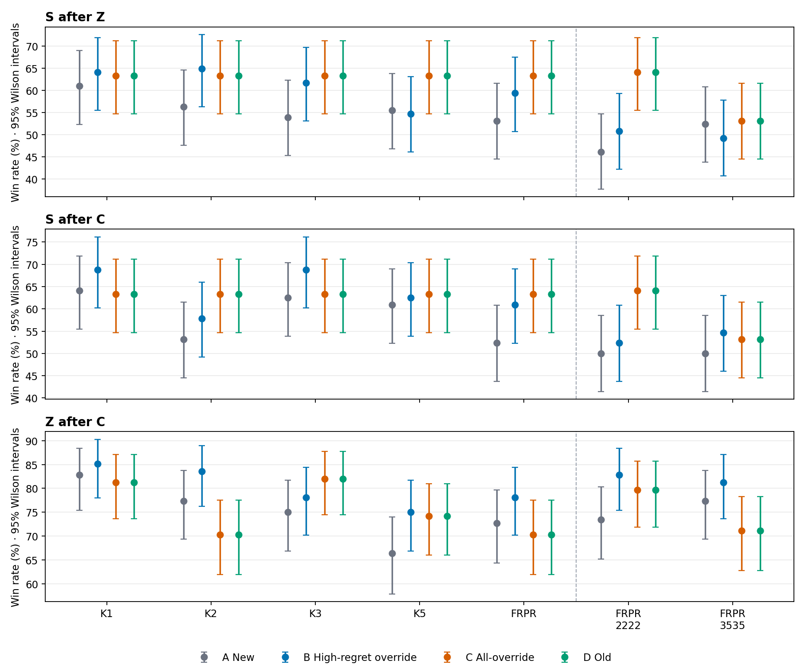
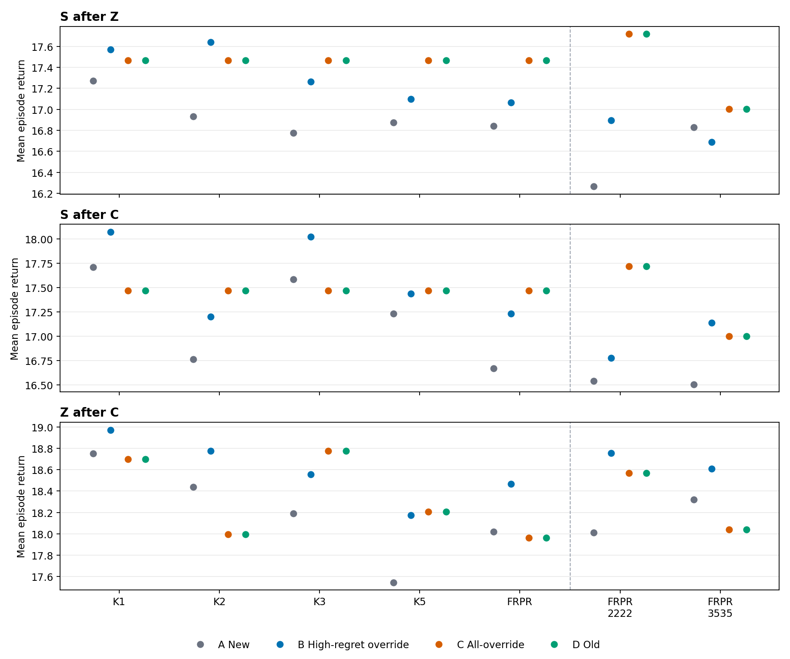
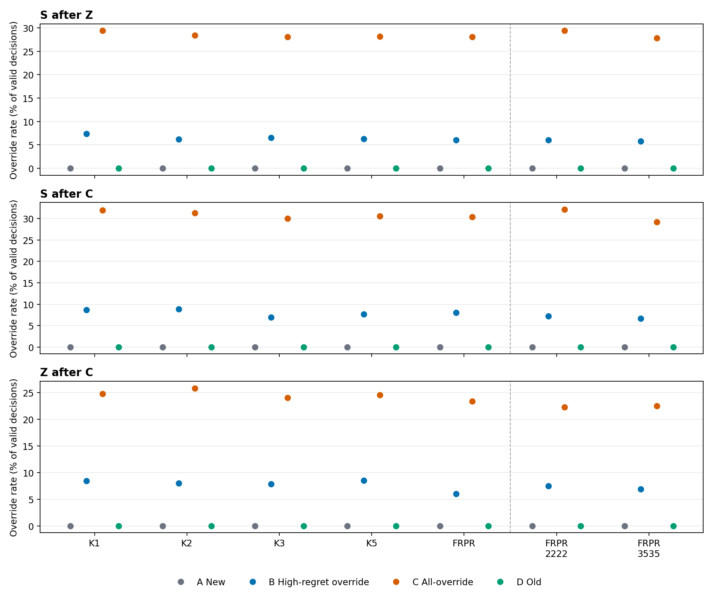

# SZC 双层 VDN64 的高损失动作在线干预

用冻结检查点在 SMACv2 镜像 5v5 上评价高损失纠正能否改善旧任务的实际胜率与回报。估计动作价值损失使用旧模型的 Q，实际胜负与回报由环境记录。检查点与 SHA-256 来自[动作价值损失实验的核验记录](../szc-vdn64-action-regret/audit.json)。

## 评价方式

主对照为同批 seed 1111 的 TKPR-K1/K2/K3/K5 和 FRPR。每条运行有三个方向，分别是 Z 末评 S、C 末评 S、C 末评 Z。S 参考是本运行的 S 末模型，Z 参考是本运行的 Z 末模型。较早的 FRPR seed 2222 和 3535 也评估相同方向，单列为补充。

| 组 | 实际执行的策略 |
| --- | --- |
| A · New | 冻结新策略的合法贪婪动作。 |
| B · High-regret override | 存活且至少有两个合法动作时，若新旧首选不同且旧 Q 的归一化损失 ≥0.5，则采用旧首选。其余情况用新首选。 |
| C · All-override | 对同样的有效决策，所有首选变化均采用旧首选。 |
| D · Old | 直接执行旧策略的合法贪婪动作。 |

在环境执行前分别更新新、旧 Agent 的 GRU，合法动作掩码相同。下一步的两个控制器都从 EpisodeBatch 读取**实际执行的上一联合动作**。每局独立重置两个隐藏状态。旧 Q 的归一化采用合法动作的总体标准差，下限为 0.1。干预前后的估计损失都由同一个旧模型在该组实际访问的状态上评价。A、D 的干预次数为零，D 仍记录假设采用新首选时的价值差。

C 和 D 在任意相同历史上都给出旧首选。强制、死亡槽位的唯一合法动作也相同。因此 C、D 的两次独立环境运行用于核验等价性；两组等价时，它们提供同一个旧策略性能参考。共享同一旧权重和环境的不同新模型共用一批 C 局和一批 D 局，但各自的新策略诊断与 C 的干预计数分别计算。A、B 每个模型对照各自运行。

### 初始状态和小样本验证

S 使用 91101–91104，Z 使用 91201–91204。每个种子块 32 局，每个条件 128 局。每块的 SMACv2 出生分布由该种子初始化，四组按相同顺序采样。每个种子块首次建局后，在生成单位前使用 SC2 QuickSave 保存初始地图快照。后续每局先 QuickLoad，再由原 SMACv2 分布生成该局的出生位置。每块的引擎初始种子为对应环境种子。逐局记录出生配置、初始单位属性、观测、全局状态、合法动作和初始时钟的指纹。配对核验覆盖同种子块、同局索引及可观测初始条件。SC2 快照接口未暴露完整内部随机状态供比较。

- 首轮试验用 SMACv2 默认重置。动作执行和历史回写通过检查，但第二局的初始状态和时钟随前一局的策略轨迹而变化。第二轮小样本改为逐局重新建局。
- 重新建局的小样本覆盖 FRPR 学 C 后评 S、K1 学 C 后评 Z，各组 2 局，共 16 次环境运行。逐步核对两个控制器的历史动作输入与环境记录相同，并检查 0.5 阈值边界、非法动作掩码、B/C 干预计数和剩余损失。4 个对照局的初始指纹匹配，C/D 联合动作和结局全部相同。第三轮改用快照恢复，16 次环境运行的初始指纹、联合动作序列、胜负、回报和干预统计均与逐局建局小样本一致。正式结果使用快照恢复批次，较慢的逐局建局批次仅保留为部分核验记录。

胜率区间使用每组 128 局的 95% Wilson 区间。回报为单局环境奖励之和，标准差使用样本标准差。干预率以该组实际访问的有效智能体决策为分母，各槽位与逐局文件保留原始计数。种子块差值和各方法的配对方向用于描述干预效果，主对照五个方法共享训练种子及部分旧轨迹。

## 结果

**只纠正归一化损失 ≥0.5 的变化，在这组旧任务评价中已取得接近全纠正的平均表现。** 主对照 15 个条件中，B 相对 A 有 14 个胜率上升、15 个回报上升。等权平均胜率增加 **5.10 个百分点**，平均回报增加 **0.396**。B 平均干预 **7.43%** 的有效智能体决策，C 为 **27.94%**。按实际次数，相同模型对照中的 B 仅执行 C 干预次数的 **20.92%–34.60%**。各组的干预率使用各自访问的有效决策作分母。

### 三个方向的平均表现

下表将 seed 1111 的五种方法等权平均。每格是**胜率 / 平均回报**。C 与 D 的物理评价分别进行，其全部轨迹动作指纹、胜负、回报及局长成对相同，因此并列展示。

| 评估方向 | A 新策略 | B 高损失纠正 | C / D 全纠正或旧策略 | A−D 胜率（百分点） | B−A 胜率（百分点） | C−B 胜率（百分点） |
| --- | ---: | ---: | ---: | ---: | ---: | ---: |
| Z 末评 S | 55.94% / 16.938 | 60.94% / 17.327 | 63.28% / 17.468 | −7.34 | +5.00 | +2.34 |
| C 末评 S | 58.59% / 17.192 | 63.75% / 17.593 | 63.28% / 17.468 | −4.69 | +5.16 | −0.47 |
| C 末评 Z | 74.84% / 18.189 | 80.00% / 18.589 | 75.63% / 18.328 | −0.78 | +5.16 | −4.38 |
| 15 个条件等权 | 63.13% / 17.440 | 68.23% / 17.836 | 67.40% / 17.755 | −4.27 | +5.10 | −0.83 |

- **原始表现变化。** 11/15 个条件的 A 胜率低于 D，差异最大的条件是 FRPR 学完 C 后评 S，52.34% 对 63.28%。也有 4 个条件的 A 胜率高于 D，其中 K2 学完 C 后评 Z 高出 7.03 个百分点。
- **全纠正与选择性纠正。** C 的胜率在 7/15 个条件高于 B，在其余 8 个条件低于 B。K5 学完 Z 后评 S，C 比 B 高 8.59 个百分点，提示较低损失的变化也可能影响表现。相反，K2 学完 C 后评 Z，B 比 C 高 13.28 个百分点。扩大干预会改变随后访问的状态和历史，比较结果反映两种干预策略在整局中的效果。
- **估计价值损失与环境结果。** B 在自己的访问历史上，干预前后的平均归一化损失由 0.1085 降到 0.0444（对 15 个条件等权），C 和 D 的剩余损失为零。结合 B 的实际胜率和回报提升，旧 Q 的高损失档在这些端点上提供了有效的干预信号。该结果针对这一整组干预，无法定位哪一次单独改变会改变结局。
- **K 值差异。** 三个方向等权时，K1/K2/K3/K5 的 B−A 胜率分别为 **+3.39/+6.51/+5.73/+3.13** 个百分点，FRPR 为 **+6.77**。K2 在 Z 末评 S 的收益较大（+8.59），K5 在该方向略降（−0.78），但在 C 末评 Z 提升 +8.59。K 的收益排序随方向变化，同批结果来自一个训练种子。
- **补充种子。** 早期 FRPR 的六个条件有五个胜率和回报上升。seed 3535 的例外仍是 Z 末评 S（B−A 为 −3.13 个百分点）。这六项与 seed 1111 的 K 消融分别统计。所有评价均在旧任务上进行，关于新任务学习的结论需要对应的训练或评价。

### 主对照 · seed 1111

| 方法 | 评估 | A 胜率 | B 胜率 | C/D 胜率 | B−A（百分点） | B / C 干预率 |
| --- | --- | ---: | ---: | ---: | ---: | ---: |
| K1 | Z 末评 S | 60.94% | 64.06% | 63.28% | +3.12 | 7.39% / 29.39% |
| K1 | C 末评 S | 64.06% | 68.75% | 63.28% | +4.69 | 8.68% / 31.93% |
| K1 | C 末评 Z | 82.81% | 85.16% | 81.25% | +2.34 | 8.43% / 24.78% |
| K2 | Z 末评 S | 56.25% | 64.84% | 63.28% | +8.59 | 6.18% / 28.45% |
| K2 | C 末评 S | 53.12% | 57.81% | 63.28% | +4.69 | 8.84% / 31.33% |
| K2 | C 末评 Z | 77.34% | 83.59% | 70.31% | +6.25 | 8.04% / 25.87% |
| K3 | Z 末评 S | 53.91% | 61.72% | 63.28% | +7.81 | 6.55% / 28.11% |
| K3 | C 末评 S | 62.50% | 68.75% | 63.28% | +6.25 | 6.91% / 30.03% |
| K3 | C 末评 Z | 75.00% | 78.12% | 82.03% | +3.12 | 7.86% / 24.10% |
| K5 | Z 末评 S | 55.47% | 54.69% | 63.28% | -0.78 | 6.32% / 28.13% |
| K5 | C 末评 S | 60.94% | 62.50% | 63.28% | +1.56 | 7.67% / 30.53% |
| K5 | C 末评 Z | 66.41% | 75.00% | 74.22% | +8.59 | 8.51% / 24.60% |
| FRPR | Z 末评 S | 53.12% | 59.38% | 63.28% | +6.25 | 6.03% / 28.08% |
| FRPR | C 末评 S | 52.34% | 60.94% | 63.28% | +8.59 | 8.01% / 30.33% |
| FRPR | C 末评 Z | 72.66% | 78.12% | 70.31% | +5.47 | 6.03% / 23.42% |

### 补充 · 早期 FRPR

| 方法 | 评估 | A 胜率 | B 胜率 | C/D 胜率 | B−A（百分点） | B / C 干预率 |
| --- | --- | ---: | ---: | ---: | ---: | ---: |
| FRPR 2222 | Z 末评 S | 46.09% | 50.78% | 64.06% | +4.69 | 6.06% / 29.41% |
| FRPR 2222 | C 末评 S | 50.00% | 52.34% | 64.06% | +2.34 | 7.23% / 32.13% |
| FRPR 2222 | C 末评 Z | 73.44% | 82.81% | 79.69% | +9.38 | 7.49% / 22.33% |
| FRPR 3535 | Z 末评 S | 52.34% | 49.22% | 53.12% | -3.12 | 5.78% / 27.86% |
| FRPR 3535 | C 末评 S | 50.00% | 54.69% | 53.12% | +4.69 | 6.67% / 29.20% |
| FRPR 3535 | C 末评 Z | 77.34% | 81.25% | 71.09% | +3.91 | 6.91% / 22.49% |

主对照的条件数、平均值与种子块差值均为描述统计。每组胜率图使用 95% Wilson 区间。多个方法共享训练种子，部分 C/D 还共享环境轨迹，表中的条件数用于计数效果方向。







## 产物和复跑

正式批次 `szc_vdn64_action_intervention_20261117_attempt002` 的 62 个评估任务和 1 个汇总任务全部正常退出。每个组条件 128 局，实际执行 7,936 局，共形成 10,752 个条件逐局记录。按方法、方向和局索引汇总，**2,688/2,688** 个四组对照的出生配置、初始可观测状态与时钟指纹均相同。C/D 的 2,688 个比较内记录也逐局一致。快照批次与逐局建局批次另有 40 个完整种子块的共同数据，对应 1,280 次环境运行，两种重置方式的块记录逐文件一致。新增训练步数为零。

- [summary.csv](summary.csv) 包含四组胜率及区间、回报均值与标准差、局长、干预计数和干预前后损失。
- [per_episode.csv](per_episode.csv) 提供逐局数据和配对指纹。[per_agent.csv](per_agent.csv) 提供各智能体槽位的计数。[contrasts.csv](contrasts.csv) 提供整体及按种子块计算的差值。
- [audit.json](audit.json) 记录检查点、种子、批次覆盖、配对和小样本核验。调度计划、原始块记录与源码快照保存在实验主机的 `results/<运行号>/`。公开目录保存轻量结果和脚本。

从包含模型、上游实验产物和 SMACv2 运行时的仓库根目录启动小样本。待 pilot 汇总通过后提交完整计划。

```sh
analysis=docs/results/behavioral-analysis/szc-vdn64-action-intervention
pilot=results/szc_vdn64_action_intervention_pilot_new
out=results/szc_vdn64_action_intervention_new
.venv/bin/python "$analysis/run_intervention.py" plan "$pilot" --pilot
.venv/bin/python scheduler/service.py submit "$pilot/plan.json"
# Pilot summary must finish first.
.venv/bin/python "$analysis/run_intervention.py" plan "$out" --pilot-audit "$pilot/public/audit.json"
.venv/bin/python scheduler/service.py submit "$out/plan.json"
```

[运行脚本](run_intervention.py)执行在线评价，[汇总脚本](summarize_intervention.py)校验覆盖和各组动作规则，将发布产物写入输出路径的 `public/`。
