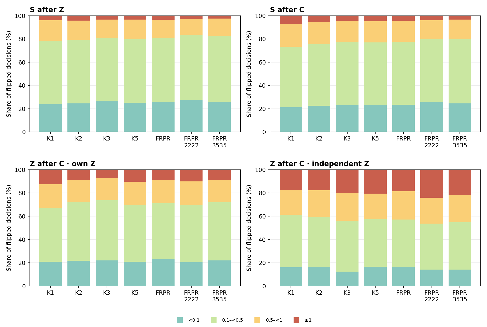
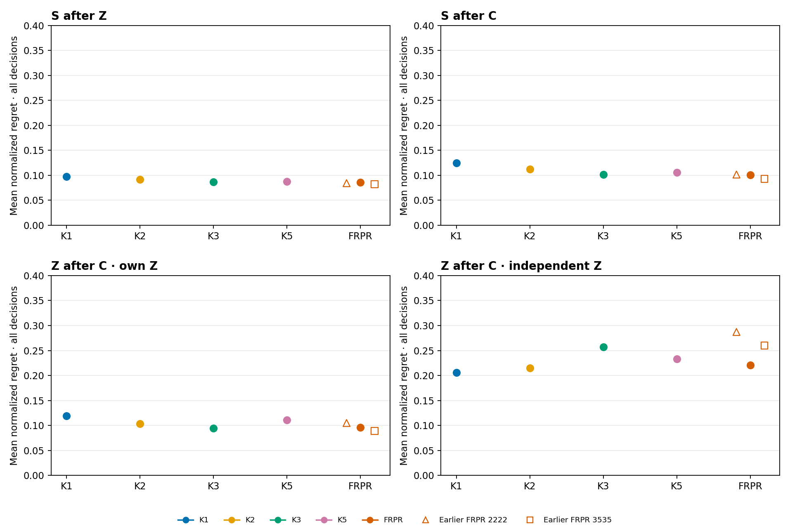
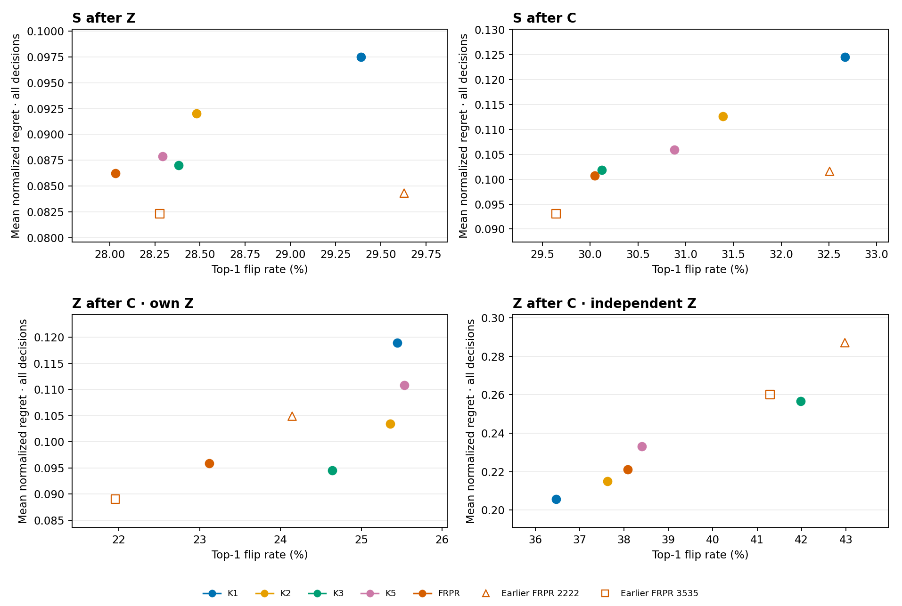
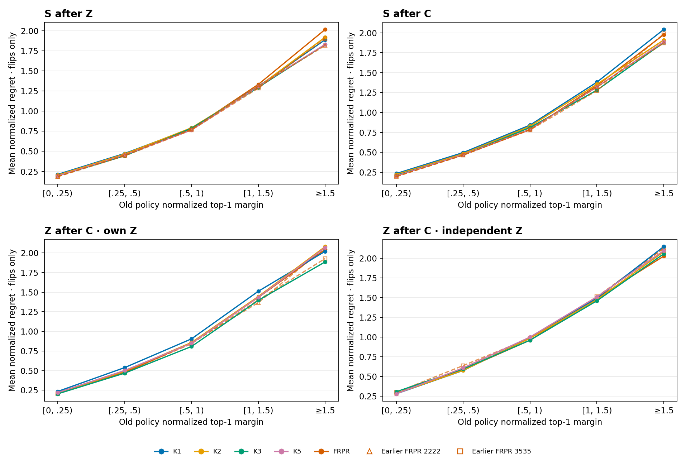

# SZC 双层 VDN64 的旧策略估计动作价值损失

复用[贪婪动作一致率实验](../szc-vdn64-greedy-action-agreement/README.md)的冻结检查点和旧策略轨迹，测量新策略改变动作后，旧模型给该动作的 Q 比旧首选动作低多少。

在原阶段参考下，**23.58%** 的动作变化落在严格低损失档（归一化损失 <0.1），**76.54%** 低于 0.5，**5.73%** 达到最高损失档（≥1）。变化主要落在较小损失区间，严格低损失只覆盖约四分之一。在统一独立 Z 参考下，最高损失档占 **20.11%**。这些是旧策略估计的动作价值损失，证据范围是给定历史上的旧模型 Q。

## 评价协议

- 输入批次为 `results/szc_vdn64_greedy_action_agreement_20261117_attempt002/`，包含 11 批参考轨迹共 1,408 局。覆盖 K1/K2/K3/K5/FRPR 同批 seed 1111 和早期 FRPR seed 2222、3535。S 在学完 Z 和 C 时分别评价，Z 在学完 C 时分别对比自身 Z 末策略和统一独立 Z 参考。
- 各模型独立重置 GRU 并使用同一局的实际观测、历史执行动作和智能体 ID。首步的历史动作输入为零向量。Q 的首选动作只在合法动作中取，遇到同分沿用最小动作索引。统计实际执行步里仍存活且至少有两个合法动作的智能体。
- 旧策略估计的动作价值损失 $R = Q_{\rm old}(s,a_{\rm old}) - Q_{\rm old}(s,a_{\rm new})$。两个动作均由各自模型在合法动作中选出，再用旧模型的 Q 计算差值。动作相同或旧 Q 并列时，$R=0$。归一化损失 $R_{\rm norm}=R/\max(\operatorname{Std}(Q_{\rm old,legal}),0.1)$，标准差采用总体定义。旧策略置信度沿用原 AGR 实验的归一化 Top-1 与 Top-2 间隔。
- VDN 团队损失为同一步各有效智能体的原始 $R$ 之和。死亡或强制动作的贡献为零。`mean_team_regret` 对所有实际执行的环境步取平均，`mean_team_regret_active_steps` 的分母为至少有一名有效智能体的环境步。该计算使用 VDN 的加和结构。
- 普通均值计入所有有效决策，`flip_` 开头的损失均值、分位数、分档占比仅以发生变化的决策为分母。CSV 空字段表示该组无相应决策。

## 变化幅度

下表合并 28 个模型对照中的动作变化。同一条轨迹可能服务多个对照，计数单位是「模型对照 × 智能体决策」。

| 参考范围 | 变化数 | [0, 0.1) | [0.1, 0.5) | [0.5, 1) | ≥1 |
| --- | ---: | ---: | ---: | ---: | ---: |
| 自身阶段参考 | 169,521 | 23.58% | 52.96% | 17.73% | 5.73% |
| 统一独立 Z 参考 | 77,586 | 15.05% | 41.91% | 22.93% | 20.11% |
| 全部对照 | 247,107 | 20.90% | 49.49% | 19.36% | 10.24% |

最高损失档占全部 802,089 个有效决策的 3.16%。自身阶段参考中该档占所有有效决策的 1.60%，统一独立 Z 参考中为 7.95%。自身阶段参考最直接衡量原阶段策略访问轨迹上的动作保留。统一 Z 对照让所有方法共享同一旧策略与轨迹，其损失也包含独立策略与各方法自身 Z 策略之间的差异。



## 方法、阶段与动作变化率

下表是 seed 1111 各方法在**全部有效决策**上的平均归一化损失。

| 方法 | 学完 Z 后评 S | 学完 C 后评 S | 学完 C 后评 Z，自身参考 | 学完 C 后评 Z，统一参考 |
| --- | ---: | ---: | ---: | ---: |
| K1 | 0.0975 | 0.1245 | 0.1190 | **0.2057** |
| K2 | 0.0920 | 0.1126 | 0.1034 | 0.2150 |
| K3 | 0.0870 | 0.1018 | **0.0945** | 0.2567 |
| K5 | 0.0879 | 0.1059 | 0.1108 | 0.2331 |
| FRPR | **0.0863** | **0.1007** | 0.0959 | 0.2211 |

S 的五组平均损失在学习 C 后均增大。FRPR 在两个 S 端点的全部决策平均损失最低，K3 与 FRPR 接近。自身 Z 对照中 K3 最低，统一 Z 对照中 K1 最低。原始 Q 差均值的各列最小值与归一化均值相同。同一方法的名次随任务和 Z 参考变化，五组同批比较只覆盖 seed 1111。早期两条 FRPR 保留在 CSV 和图中，训练版本差异见原 AGR 报告。

接近的 AGR 可以对应不同的价值损失。在同一批 S 轨迹上，Z 末 K2 和 K3 的动作变化率为 **28.48% 和 28.38%**，但变化中的最高损失档占 **4.21% 和 3.31%**。C 末对自身 Z 参考，K1 和 K2 的变化率为 **25.44% 和 25.35%**，仅在变化时的平均归一化损失为 **0.468 和 0.408**，最高损失档占 **12.43% 和 8.77%**。这个 Z 对照的两种旧策略各自生成轨迹。

团队损失的平均值给出了每个环境步的累积量。例如在 C 末的同一批 S 轨迹上，FRPR、K3、K1 的平均团队原始损失分别为 0.0362、0.0366、0.0448。





## 高置信度变化更少，发生时价值差更大

28 个对照中，变化决策的平均原始和归一化损失均在五个置信度档单调上升。以同批五组 C 末评 S 为例，最低档有 29,957 次变化（50.49%），变化时平均归一化损失为 **0.216**。最高档有 134 次变化（2.42%），变化时平均损失为 **1.952**。在同一状态，任何改选的合法动作在旧 Q 下最多与旧 Top-2 等值，所以 Top-1 间隔是归一化损失的下界。含未变化决策的平均损失还取决于变化概率，本次 28 个对照均未随置信度单调上升。



## 核验和复跑

[核验记录](audit.json)列出 44 个轨迹归档、22 个检查点路径及其 SHA-256。旧模型在 1,408 局上逐步复现全部 413,520 个已执行智能体动作（含强制动作）。28 个总体、3,584 个逐局、140 个逐智能体和 140 个置信度分组的有效决策与动作变化计数均与原 AGR CSV 一致。团队损失总和与有效智能体原始损失总和一致。正式批次为 `szc_vdn64_action_regret_20261117_attempt001`，新增环境轨迹和训练步数均为零。

- [summary.csv](summary.csv) 保存两个分母下的均值、变化损失中位数和 P90、分档计数、团队值和检查点路径。
- [per_episode.csv](per_episode.csv)、[per_agent.csv](per_agent.csv)、[confidence.csv](confidence.csv) 分别保存逐局、逐智能体槽位和逐置信度档的统计。
- 原轨迹和权重留在实验主机。含原始输入的仓库可用 [分析脚本](analyze_action_regret.py) 复算。输出路径需指向新目录。

```sh
analysis=docs/results/behavioral-analysis/szc-vdn64-action-regret
.venv/bin/python "$analysis/analyze_action_regret.py" \
  results/szc_vdn64_greedy_action_agreement_20261117_attempt002 \
  results/szc_vdn64_action_regret_new
```
