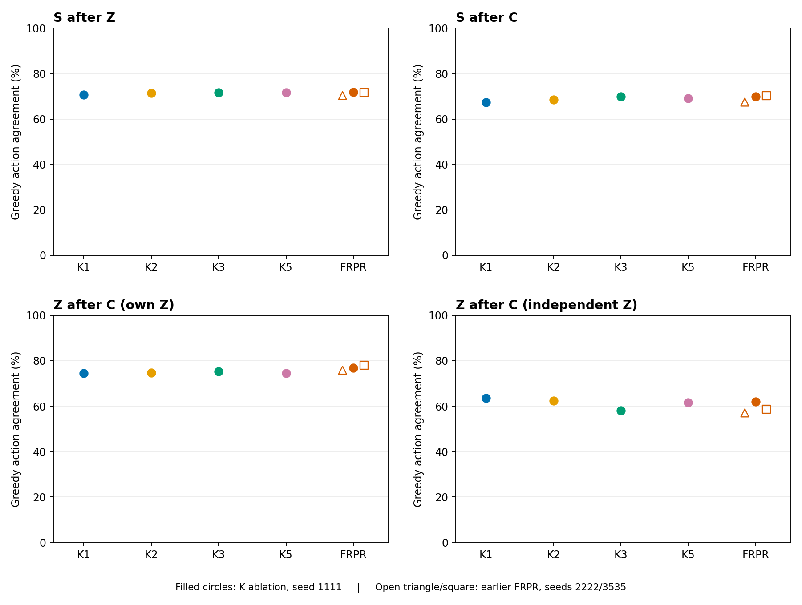
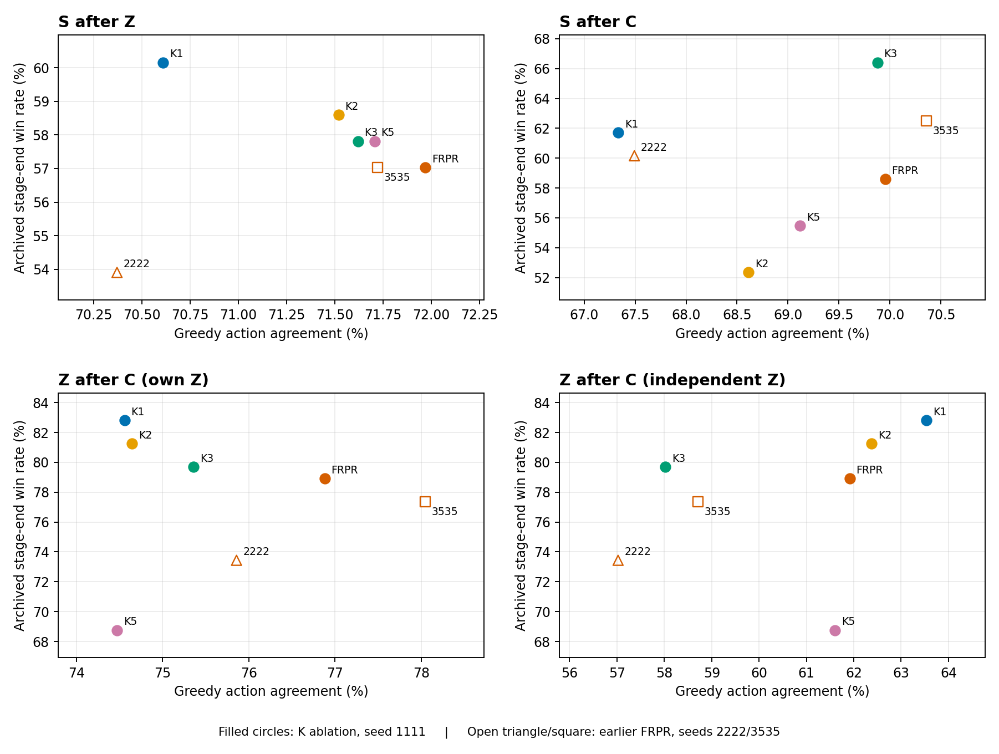

# SZC 双层 VDN64 的贪婪动作一致率

在追猎者（S）→ 狂热者（Z）→ 巨像（C）的持续学习序列中，测量学习新任务后，模型在旧策略访问的历史上有多常选出同一个贪婪动作，并与对应检查点的旧任务胜率对照。

## 检查点与评价协议

- 主对照为 seed 1111 的 TKPR-K1、K2、K3、K5 与 FRPR，训练提交为 `f332d9e`。五组名义累计端点为 2M、4M、6M 步，按整局保留实际步数。五个 S 末 Agent 文件的 SHA-256 相同，S 任务的主对照共用同一批轨迹。
- 补充 seed 2222、3535 的原 FRPR，训练提交为 `d96055f`。它们也使用逐任务 ε 和逐阶段重建 TD 缓冲区，但历史参考 Q 在训练时离线重算。seed 1111 同批 FRPR 在采集偏好回放轨迹时记录旧 Q。两个补充种子仅提供描述性补充。FRPR-ReLU、Unfiltered、Raw 和 K10 超出本次方法范围。
- S 使用每条运行的 S 末策略生成轨迹，对照 Z 末和 C 末模型。Z 主分析使用该运行自己的 Z 末策略生成轨迹，对照 C 末模型。统一 Z 对照对全部七条运行使用同一个独立训练到 2M 的 seed 1111 Z 模型（`vdnh_Z_seed1111_20261103_attempt001`，`94f2a66`），在同一 SZC 精确镜像 5v5 环境中采样。该模型在本次环境采集赢了 105/128 局，旧 History 评价日志为 100/128。统一参考的 AGR 以本次共用轨迹为准。
- S 使用环境种子 91101–91104，Z 使用 91201–91204，每块 32 局，与主实验阶段末评价种子方案相同。每局记录完整观测、合法动作、执行动作及终止观测。新旧 Agent 各自以零隐藏状态从头离线展开同一局，输入为同一观测、上一条实际执行动作的 one-hot 和相同智能体 ID。首步上一动作输入为零向量。
- 在实际环境步上屏蔽非法动作，按最大 Q 取首选动作。同分时沿用 PyTorch Argmax 的最小动作索引。仅统计存活且至少有两个合法动作的智能体决策。分子和分母跨有效决策求和得到 AGR，Flip Rate 为 100% − AGR。逐局均值对含有效决策的回合等权，逐智能体指标按槽位统计。
- 置信度采用旧模型合法动作的 `(Q_top1 − Q_top2) / max(std(Q_legal), 0.1)`，标准差用总体定义。分箱为 [0, 0.25)、[0.25, 0.5)、[0.5, 1)、[1, 1.5)、[1.5, ∞)。每箱以其中有效决策为分母。
- 胜率直接取历史 `evaluations.jsonl` 中任务、阶段和实际步数均匹配的 `stage_end` 记录，并与 `retention.json` 交叉核对。每个胜率为 128 局。相关系数分任务、阶段和参考策略计算，每个点对应一条运行的一个模型端点。

## 结果

表中每格为 **AGR / 对应端点旧任务胜率**，单位均为百分比。S 的变化量使用未四舍五入的 AGR 计算。

| 方法 / seed | Z 末评 S | C 末评 S | S 的 AGR 变化（百分点） | C 末评 Z，自身参考 | C 末评 Z，统一参考 |
| --- | ---: | ---: | ---: | ---: | ---: |
| K1 / 1111 | 70.61 / 60.16 | 67.33 / 61.72 | −3.28 | 74.56 / 82.81 | 63.53 / 82.81 |
| K2 / 1111 | 71.52 / 58.59 | 68.61 / 52.34 | −2.91 | 74.65 / 81.25 | 62.38 / 81.25 |
| K3 / 1111 | 71.62 / 57.81 | 69.88 / 66.41 | −1.74 | 75.36 / 79.69 | 58.02 / 79.69 |
| K5 / 1111 | 71.71 / 57.81 | 69.12 / 55.47 | −2.59 | 74.47 / 68.75 | 61.60 / 68.75 |
| FRPR / 1111 | 71.97 / 57.03 | 69.95 / 58.59 | −2.02 | 76.88 / 78.91 | 61.92 / 78.91 |
| FRPR / 2222（早期） | 70.37 / 53.91 | 67.49 / 60.16 | −2.88 | 75.86 / 73.44 | 57.02 / 73.44 |
| FRPR / 3535（早期） | 71.72 / 57.03 | 70.36 / 62.50 | −1.37 | 78.04 / 77.34 | 58.71 / 77.34 |

在同批五组中，学完 Z 后，S 保留了 70.61%–71.97% 的首选动作。继续学 C 后，五组在完全相同的 S 历史上又下降了 1.74–3.28 个百分点，落在 67.33%–69.95%。C 末对自身 Z 策略的 AGR 为 74.47%–76.88%，对统一独立 Z 策略为 58.02%–63.53%。后一组差值同时反映参考策略与轨迹分布的变化。

同批 FRPR 在两个 S 端点和自身 Z 对照中最高。C 末的 S 上，FRPR（69.95%）与 K3（69.88%）只相差约 0.07 个百分点，K3 的 S 一致率从 Z 到 C 下降最少。统一 Z 对照由 K1 最高（63.53%）。这五个方法的相对顺序来自一次配对训练种子，换 Z 参考策略后已经出现排序变化。



### AGR 与旧任务胜率

| 任务和评估端点 | seed 1111 Pearson r | seed 1111 Spearman ρ | 含两个早期 FRPR Pearson r | 含两个早期 FRPR Spearman ρ |
| --- | ---: | ---: | ---: | ---: |
| Z 末评 S | −0.981 | −0.975 | +0.210 | −0.218 |
| C 末评 S | +0.159 | +0.200 | +0.204 | +0.250 |
| C 末评 Z，自身参考 | +0.164 | 0.000 | +0.016 | −0.143 |
| C 末评 Z，统一参考 | +0.135 | +0.700 | +0.336 | +0.643 |

Z 末的 S 在同批五组中呈强负相关，五组 AGR 仅相差 1.36 个百分点。加入两条早期 FRPR 后，Pearson 变为 +0.210。C 末的 S 和自身 Z 对照关联较弱。统一 Z 的 Spearman 较高，Pearson 较低，且自身 Z 对照未复现该排序趋势。当前每组相关只有 5 或 7 个端点，补充样本还同时改变了种子和历史 Q 记录实现。AGR 在这些结果中缺乏稳定预测旧任务胜率的证据。比如同批 K1 学完 C 后在 S 上比 Z 末少保留 3.28 个百分点的首选动作，S 胜率却从 60.16% 升至 61.72%。



### 旧策略置信度

下表按有效决策数汇总同批五组。各比较的分组分母见 [confidence.csv](confidence.csv)。

| 任务和评估端点 | [0, 0.25) | [0.25, 0.5) | [0.5, 1) | [1, 1.5) | ≥1.5 |
| --- | ---: | ---: | ---: | ---: | ---: |
| Z 末评 S | 51.49% | 75.19% | 89.81% | 96.37% | 98.66% |
| C 末评 S | 49.51% | 71.49% | 87.04% | 94.77% | 97.58% |
| C 末评 Z，自身参考 | 50.04% | 71.35% | 86.64% | 94.90% | 97.76% |
| C 末评 Z，统一参考 | 38.05% | 60.00% | 71.95% | 80.58% | 90.52% |

28 个比较各自的五档 AGR 都随旧 Q 间隔严格上升。该规律也出现在统一 Z 参考上，覆盖本次七条训练运行的旧策略访问分布。

## 数据和复跑

- [summary.csv](summary.csv) 含 28 个比较的 AGR、Flip Rate、逐局均值、端点胜率计数与模型来源。
- [per_episode.csv](per_episode.csv) 含 3,584 条比较内逐局记录。[per_agent.csv](per_agent.csv) 含五个智能体槽位的计数和 AGR。[confidence.csv](confidence.csv) 和 [correlation.csv](correlation.csv) 提供分箱和相关统计。
- [manifest.json](manifest.json) 记录原运行、训练提交、端点步数与权重哈希。[rollout_audit.json](rollout_audit.json) 记录 11 批参考轨迹共 1,408 局轨迹的档案哈希。旧模型离线回放的贪婪动作与执行动作逐步一致。十批自身阶段参考共 1,280 局的胜负、局长与原阶段末日志逐局一致。
- 正式运行号为 `szc_vdn64_greedy_action_agreement_20261117_attempt002`，11 个评估任务和 1 个汇总任务均退出 0。首次尝试因分析脚本解包置信度函数返回值时出错而终止。修正仅涉及该脚本。原始轨迹、计划和源码快照保存在实验主机的 `results/<运行号>/` 下。新增训练步数为零。

从含原始运行和 SMACv2 运行时的仓库根目录复跑，给新批次使用唯一目录。

```sh
analysis=docs/results/behavioral-analysis/szc-vdn64-greedy-action-agreement
out=results/szc_vdn64_greedy_action_agreement_new
.venv/bin/python "$analysis/run_analysis.py" plan "$out"
.venv/bin/python scheduler/service.py submit "$out/plan.json"
```

调度器执行 [run_analysis.py](run_analysis.py) 的 `collect` 和 [summarize.py](summarize.py)，将轻量产物写到 `$out/public/`。
