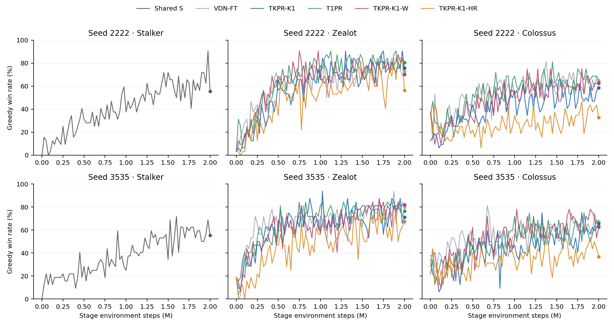

# SZC 双层 VDN64 · TKPR-K1 共同前缀对照

已完成 2/2 个 S 前缀和 10/10 个 Z→C 分支。10/10 个分支记录的恢复模型指纹与父运行一致。

镜像 5v5 追猎者 → 狂热者 → 巨像，累计阈值 2M／4M／6M，逐任务 ε 和 FT。每个 seed 的五个分支共用 S 末的在线／目标网络、RMSprop 状态、计数和环境分布随机状态。偏好分支共用 S 阶段的冻结旧 Q 胜局记忆。Z 末各自采集记忆，C 阶段的 Z 来源因此可以不同。分支重启 SC2 进程。配对以 seed 和父运行 ID 为键。

## 逐种子结果

| 方法 | Seed | C 末 S/Z/C 胜率 % | ACC % | BWT pp | FWT pp | Z AUC % | C AUC % |
| --- | ---: | --- | ---: | ---: | ---: | ---: | ---: |
| TKPR-K1 | 2222 | 56.25 / 75.00 / 58.59 | 63.28 | 0.00 | 20.31 | 58.81 | 42.20 |
| TKPR-K1 | 3535 | 49.22 / 77.34 / 65.62 | 64.06 | 0.00 | 27.73 | 63.88 | 43.56 |
| VDN-FT | 2222 | 0.00 / 0.00 / 64.84 | 21.61 | -64.06 | 23.83 | 62.39 | 53.57 |
| VDN-FT | 3535 | 0.00 / 0.00 / 67.19 | 22.40 | -67.58 | 28.12 | 65.97 | 54.50 |
| T1PR | 2222 | 34.38 / 75.78 / 63.28 | 57.81 | -12.89 | 21.09 | 66.19 | 53.97 |
| T1PR | 3535 | 42.19 / 79.69 / 63.28 | 61.72 | -5.08 | 26.17 | 66.57 | 50.10 |
| TKPR-K1-W | 2222 | 50.78 / 82.03 / 62.50 | 65.10 | 3.52 | 14.84 | 64.40 | 48.16 |
| TKPR-K1-W | 3535 | 46.88 / 81.25 / 62.50 | 63.54 | -4.69 | 26.17 | 63.09 | 52.93 |
| TKPR-K1-HR | 2222 | 56.25 / 61.72 / 32.81 | 50.26 | 3.12 | 21.48 | 51.31 | 26.75 |
| TKPR-K1-HR | 3535 | 50.78 / 68.75 / 36.72 | 52.08 | -1.56 | 26.56 | 47.22 | 34.35 |

### 同种子配对差值

| 方法 | 对照 | Seed | ΔACC pp | ΔBWT pp | ΔFWT pp | ΔC AUC pp |
| --- | --- | --- | ---: | ---: | ---: | ---: |
| TKPR-K1 | VDN-FT | 2222, 3535 | 41.67 | 65.82 | -1.95 | -11.16 |
| T1PR | VDN-FT | 2222, 3535 | 37.76 | 56.84 | -2.34 | -2.00 |
| T1PR | TKPR-K1 | 2222, 3535 | -3.91 | -8.98 | -0.39 | 9.16 |
| TKPR-K1-W | VDN-FT | 2222, 3535 | 42.32 | 65.23 | -5.47 | -3.49 |
| TKPR-K1-W | TKPR-K1 | 2222, 3535 | 0.65 | -0.59 | -3.52 | 7.67 |
| TKPR-K1-HR | VDN-FT | 2222, 3535 | 29.17 | 66.60 | -1.95 | -23.49 |
| TKPR-K1-HR | TKPR-K1 | 2222, 3535 | -12.50 | 0.78 | 0.00 | -12.33 |

AUC 按实际阶段步数，将当前任务的起点、定期点和阶段末胜率做梯形积分后归一化。定期点使用 32 局，阶段末使用 128 局。跨种子汇总使用训练 seed 等权。

## 配对更新时间

两组每次使用同一在线／目标网络、优化器状态和已搬运到 GPU 的 TD batch。每个快照分别预热两个条件，交替测量顺序。计时前后同步 GPU。TD+TKPR-K1 包含历史采样、历史前向、损失、联合反传和优化步骤。输出不计文件写入、环境 rollout、TD 采样和梯度诊断。

| 阶段 | 快照数 | 配对数 | TD ms/update | TD+K1 ms/update | 额外 ms/update | 额外比例 % |
| --- | ---: | ---: | ---: | ---: | ---: | ---: |
| zealot | 6 | 120 | 41.74 | 58.81 | 17.08 | 40.92 |
| colossus | 6 | 120 | 50.57 | 85.34 | 34.77 | 68.75 |

## 数据

- [运行清单](runs.csv)与[配置快照](configs/)提供父子关系和实际训练版本。S 的原始评价仅保存在父运行下，计算整个分支的阶段指标时按父运行关联。
- [逐次评价](evaluations.csv)、[学习曲线](learning_curves.csv)、[阶段指标](stage_metrics.csv)和[同前缀差值](paired_metrics.csv)。差值为方法减对照，ACC／BWT／FWT／AUC 的差值单位均为百分点。
- [偏好与机制](preference_diagnostics.csv)和[梯度](gradient_diagnostics.csv)。置信度、HR 损失及 regret 的汇总使用对应状态数作为权重，计数包含历史重复采样。
- [计时汇总](timing_summary.csv)记录分阶段和分种子结果。
- [逐次配对计时](timing_samples.csv)和[计时配置](timing_protocol.json)。
