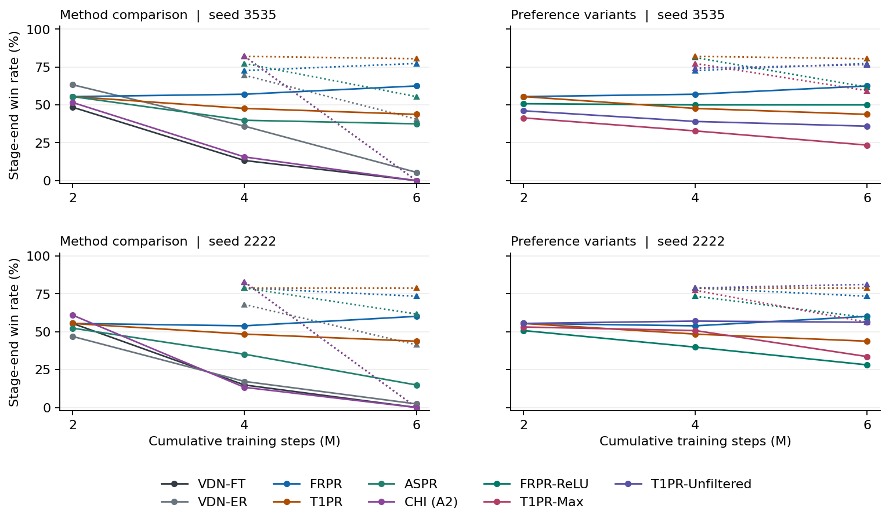

# SZC 双层 VDN64 · 近期约束方法结果

[实验结果索引](../../README.md) · [运行清单](runs.csv) · [生效配置](configs/) · [数据说明](../../DATA.md)

在相同三任务顺序下比较偏好回放、CHI 软保护与两种 VDN 基线，观察保持旧任务的收益及当前任务的学习代价。截至 2026-11-17，数据表收录 18 种方法或设置、33 条已完成的独立训练。种子覆盖 1111、2222、3535，各方法覆盖范围见运行清单。

SMACv2（StarCraft II 4.10） 镜像 5v5，追猎者 S → 狂热者 Z → 巨像 C，累计阈值 2M/4M/6M 后完成当局。双层 VDN64，逐任务 ε 退火，FT 组逐阶段重建或清空 TD 回放池，VDN-ER 保留历史轨迹并按任务均衡采样。每个阶段末对各已见任务进行 128 局独立贪心评估，Z/C 初始与首次训练前使用相同任务种子块。

## 新增结果

以下汇总覆盖新增方法。跨方法比较请使用共有种子，均值按每组现有种子等权计算。

| 方法 | Seed（最终 ACC） | 平均 ACC % | 平均 BWT（百分点） | 平均 FWT（百分点） |
| --- | --- | ---: | ---: | ---: |
| FRPR-Unfiltered | 2222（58.59%）, 3535（58.85%） | 58.72 | +3.91 | +25.98 |
| FRPR-Raw | 1111（53.91%）, 3535（62.50%） | 58.20 | -5.66 | +24.41 |
| FRPR-RawLoss | 1111（58.33%）, 3535（55.99%） | 57.16 | +0.39 | +27.54 |
| TKPR-K1 | 1111（67.45%） | 67.45 | +3.52 | +38.67 |
| TKPR-K2 | 1111（64.06%） | 64.06 | -3.12 | +37.11 |
| TKPR-K3 | 1111（67.19%） | 67.19 | +1.17 | +29.30 |
| TKPR-K5 | 1111（57.29%） | 57.29 | -4.30 | +32.03 |
| TKPR-K10 | 1111（63.54%）, 3535（54.17%） | 58.85 | -3.32 | +31.45 |
| VDN-ER+CHI | 1111（26.56%）, 3535（30.73%） | 28.65 | -48.05 | +24.22 |

### FRPR 标准化对照

| Seed | 原 FRPR ACC % | Raw ACC % | RawLoss ACC % | Raw − 原版（百分点） | RawLoss − 原版（百分点） |
| --- | ---: | ---: | ---: | ---: | ---: |
| 3535 | 67.45 | 62.50 | 55.99 | -4.95 | -11.46 |
| 1111 | 65.89 | 53.91 | 58.33 | -11.98 | -7.55 |

Raw 使用原始旧 Q 差筛选（`min_gap_raw=0.1`），并使用原始新 Q 差计算 Softplus。RawLoss 沿用原版的归一化旧 Q 筛选（`min_gap=0.5`，`q_scale_floor=0.1`），只在 Softplus 中改用原始新 Q 差。权重和温度均为 1.0。四条从头训练的变体使用同一源码提交。Raw 与 RawLoss 的 ACC 排序随种子翻转。对原版的同种子比较使用历史运行，seed 1111 与 3535 的原版来自不同代码提交，seed 3535 还涉及历史旧 Q 的保存方式变化。

TKPR-K1/K2/K3/K5 与原 FRPR 的同批对照，以及 K 有效分布和梯度定义，见 [K 值消融](../../parameter-ablations/szc-vdn64-tkpr-k/README.md)。K10 的 seed 1111 和 3535 来自后续批次。VDN-ER + CHI 与 VDN-ER 或 A2 CHI 的交集只有 seed 3535，前者还涉及驱动差异。

### 给 ChatGPT 的数据入口

1. [运行清单](runs.csv)提供 `run_id`、`cohort`、训练种子、训练提交和生效配置。
2. [阶段指标](stage_metrics.csv)包含逐种子 S/Z/C 末矩阵和 ACC、BWT、FWT。 [同种子终点差](paired_final.csv)提供实际对照运行 ID 和以百分点计的差值。
3. [评估记录](evaluations.csv)包含所有训练期曲线采样点、阶段末、初始和首次训练前评估的胜局数、局数及累计步数。
4. [偏好诊断](preference_diagnostics.csv)、[Agent 梯度](gradient_diagnostics.csv)、[有效 K](effective_k_histogram.csv)、[ER + CHI 阶段首批回放](replay_samples.csv)与 [CHI 保护名单](chi_selection.json)可按 `run_id` 关联。空字段表示该指标缺失或不适用。
5. [TS4 偏好回访](../../return-ablations/ts4-vdn64-ranking/README.md)包含继续与取消约束的配对分支。按其父运行配对。[策略行为分析](../../README.md#策略行为分析)提供同一批 SZC 检查点的动作一致率、价值损失与纠正干预。

## 首批九组对照

以下图表和文字保留种子 3535、2222 的首批 18 条结果。其余运行以新增结果表及完整 CSV 为准。

## 旧任务保留与当前任务学习

圆点实线是追猎者，三角点线是狂热者。每个点来自对应阶段末的 128 局贪心评估。点间连线连接阶段测量，阶段内的旧任务胜率未定期采样。

[当前任务学习曲线 · 主方法与基线](current_task.png) · [当前任务学习曲线 · 偏好变体](current_task_variants.png)。细竖线标记各运行该阶段的实际起点；圆点是阶段末评估。定期点每次 32 局，偏好驱动从阶段起点安排 25k 评估，CHI 驱动按全局步数对齐。

## 两种子平均

| 方法 | 最终 ACC % | ΔACC 对 VDN-FT（百分点） | 最终 BWT（百分点） | FWT（百分点） | C 末 S/Z/C 胜率 % |
| --- | ---: | ---: | ---: | ---: | --- |
| VDN-FT | 22.14 | — | -67.19 | +22.07 | 0.00 / 0.00 / 66.41 |
| T1PR | 60.94 | +38.80 | -6.25 | +20.90 | 43.75 / 79.69 / 59.38 |
| FRPR | 65.89 | +43.75 | +2.73 | +27.15 | 61.33 / 75.39 / 60.94 |
| ASPR | 49.74 | +27.60 | -23.63 | +23.83 | 26.17 / 58.59 / 64.45 |
| CHI 软保护（A2） | 20.05 | -2.08 | -69.34 | +21.68 | 0.00 / 0.00 / 60.16 |
| FRPR-ReLU | 51.82 | +29.69 | -14.26 | +26.95 | 39.06 / 60.55 / 55.86 |
| T1PR-Max | 52.47 | +30.34 | -19.14 | +22.46 | 28.52 / 57.81 / 71.09 |
| VDN-ER | 34.24 | +12.11 | -39.45 | +24.61 | 3.91 / 41.02 / 57.81 |
| T1PR-Unfiltered | 60.94 | +38.80 | -1.17 | +28.52 | 46.09 / 78.91 / 57.81 |

## 逐种子阶段末胜率矩阵

每格按 S、Z、C 的顺序列出已见任务胜率（%）。ACC 是 C 末三个任务的平均胜率，BWT 是 C 末 S/Z 相对于各自学完时的平均变化，FWT 是 Z/C 首次训练前相对于各自初始模型的平均变化。

| 方法 | Seed | S 末 | Z 末 | C 末 | 最终 ACC % | BWT（百分点） | FWT（百分点） |
| --- | ---: | --- | --- | --- | ---: | ---: | ---: |
| VDN-FT | 3535 | 48.44 | 13.28 / 82.03 | 0.00 / 0.00 / 67.19 | 22.40 | -65.23 | +24.61 |
| VDN-FT | 2222 | 55.47 | 14.84 / 82.81 | 0.00 / 0.00 / 65.62 | 21.88 | -69.14 | +19.53 |
| T1PR | 3535 | 55.47 | 47.66 / 82.03 | 43.75 / 80.47 / 58.59 | 60.94 | -6.64 | +22.27 |
| T1PR | 2222 | 55.47 | 48.44 / 78.91 | 43.75 / 78.91 / 60.16 | 60.94 | -5.86 | +19.53 |
| FRPR | 3535 | 55.47 | 57.03 / 72.66 | 62.50 / 77.34 / 62.50 | 67.45 | +5.86 | +32.42 |
| FRPR | 2222 | 55.47 | 53.91 / 78.91 | 60.16 / 73.44 / 59.38 | 64.32 | -0.39 | +21.88 |
| ASPR | 3535 | 55.47 | 39.84 / 77.34 | 37.50 / 55.47 / 61.72 | 51.56 | -19.92 | +28.52 |
| ASPR | 2222 | 52.34 | 35.16 / 78.91 | 14.84 / 61.72 / 67.19 | 47.92 | -27.34 | +19.14 |
| CHI 软保护（A2） | 3535 | 51.56 | 15.62 / 82.03 | 0.00 / 0.00 / 66.41 | 22.14 | -66.80 | +17.19 |
| CHI 软保护（A2） | 2222 | 60.94 | 13.28 / 82.81 | 0.00 / 0.00 / 53.91 | 17.97 | -71.88 | +26.17 |
| FRPR-ReLU | 3535 | 50.78 | 50.00 / 81.25 | 50.00 / 61.72 / 58.59 | 56.77 | -10.16 | +31.64 |
| FRPR-ReLU | 2222 | 50.78 | 39.84 / 73.44 | 28.12 / 59.38 / 53.12 | 46.88 | -18.36 | +22.27 |
| T1PR-Max | 3535 | 41.41 | 32.81 / 77.34 | 23.44 / 59.38 / 67.19 | 50.00 | -17.97 | +30.47 |
| T1PR-Max | 2222 | 53.12 | 50.78 / 77.34 | 33.59 / 56.25 / 75.00 | 54.95 | -20.31 | +14.45 |
| VDN-ER | 3535 | 63.28 | 35.94 / 69.53 | 5.47 / 40.62 / 59.38 | 35.16 | -43.36 | +26.17 |
| VDN-ER | 2222 | 46.88 | 17.19 / 67.97 | 2.34 / 41.41 / 56.25 | 33.33 | -35.55 | +23.05 |
| T1PR-Unfiltered | 3535 | 46.09 | 39.06 / 74.22 | 35.94 / 76.56 / 64.06 | 58.85 | -3.91 | +32.81 |
| T1PR-Unfiltered | 2222 | 55.47 | 57.03 / 78.91 | 56.25 / 81.25 / 51.56 | 63.02 | +1.56 | +24.22 |

## 结果解释

- FRPR 在两个种子上的最终 ACC 都最高，相对 VDN-FT 平均高 43.75 个百分点。C 末 FRPR 的 S/Z 胜率平均为 61.33%/75.39%，VDN-FT 两项均为 0%。FRPR 的 C 胜率是 60.94%，比 VDN-FT 低 5.47 个百分点。
- CHI 两个种子在两次切换均生成了有效保护名单。seed 3535 在 Z→C 时有一个 A2 单元退出保护，seed 2222 两次名单一致。CHI 的 C 末 S/Z 胜率均为 0%，最终 ACC 比 VDN-FT 低 2.08 个百分点。
- FRPR-ReLU 的最终 ACC 比原 FRPR 低 14.06 个百分点，T1PR-Max 比原 T1PR 低 8.46 个百分点。新版采用提交 `ddbe70e` 的历史轨迹旧 Q 记录实现，原版采用 `d96055f`。这些差异描述了两个种子在各自实现下的结果，损失函数替换的独立效应仍待区分。CHI 与 VDN-FT 分别使用镜像任务驱动和偏好回放驱动。

- VDN-ER 两个种子的最终 ACC 都高于 VDN-FT，平均高 12.11 个百分点。两条运行在 Z 阶段首批更新均按 S/Z 各 16 局抽样，C 阶段首批为 S/Z/C 各 8/8/16 局。VDN-ER 两个种子的启动提交分别为 `ddbe70e` 和 `4266b26`。
- T1PR-Unfiltered 与原 T1PR 的平均最终 ACC 均为 60.94%。相对原版，seed 3535 低 2.08 个百分点，seed 2222 高 2.08 个百分点。无阈值版平均 BWT 高 5.08 个百分点，FWT 高 7.62 个百分点。无阈值版运行于 `4266b26`，与原版的比较也包含历史轨迹旧 Q 记录实现的版本差异。

## 下载数据

- [逐次独立评估](evaluations.csv)包含完整的定期学习点、阶段末矩阵、初始参考与首次训练前评估。
- [逐种子阶段指标](stage_metrics.csv)由胜局数和局数重算，保留完整精度。
- [偏好回放诊断](preference_diagnostics.csv)按阶段和历史任务汇总采样回合、有效决策与约束计数。[CHI 名单](chi_selection.json)记录每次切换的保护与恢复单元。
- [运行清单](runs.csv)列出训练 commit 和逐运行配置文件。实现说明见[偏好回放](../../../VDN_ACTION_SET_PREFERENCE.md)及 [CHI](../../../METHODS.md#vdn-历史探测集重评估chi)。本节结论范围为首批两个训练种子。
