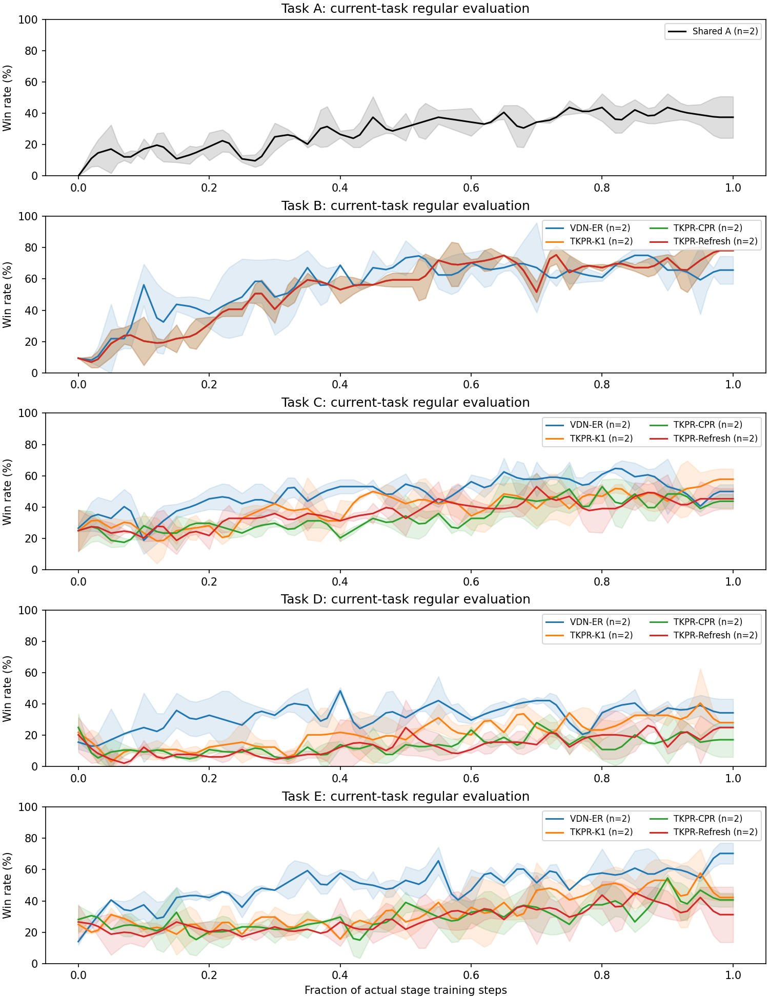
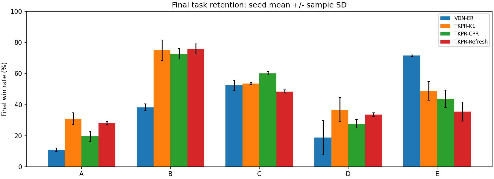
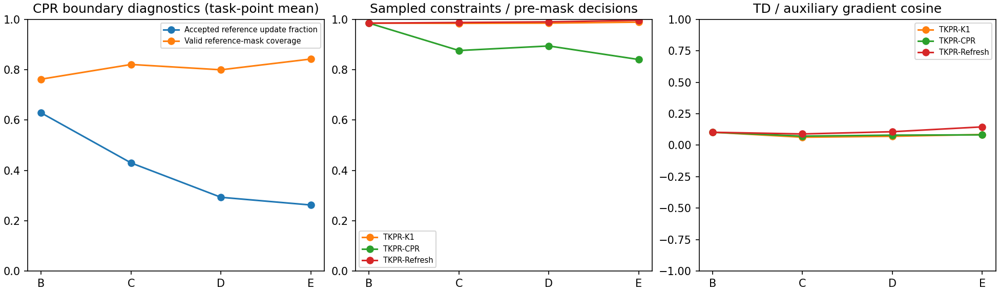

# TS5-1M · TKPR-CPR 共同前缀四方法对照

**状态：全部训练与独立进程复核完成。**

分组：VDN-ER、TKPR-K1、TKPR-CPR、TKPR-Refresh；训练种子3535、2222。统一 vdn_action_set + vdn_1ff，TS5 A→B→C→D→E，每阶段名义1M，累计阈值后的整回合末切换，逐任务 ε 退火。每种子仅训练一次A前缀，四分支分别新增B–E共4M；两前缀加八分支名义新增34M。没有新增FT组；旧2M FT数据不作为本批同前缀配对对照。

## 前缀与初始化

共同A用K1入口训练；A没有历史辅助约束。full_shared_prefix 模式保存online/target、optimizer、完整A ReplayBuffer、训练与探索计数、Python/NumPy/Torch/CUDA RNG、环境分布状态、偏好采样RNG及成功Memory。原共享入口未保存ReplayBuffer且不支持ER分支，此模式显式补齐，原模式不变。ER继承A回放并按原均衡规则进入B；K1/CPR/Refresh恢复后按既有FT规则在B清空TD池。每分支单独保存最终ReplayBuffer及各阶段模型，父运行不被写入。

A成功池仅采集一次，所有分支的obs/actions/old_q_values指纹相同。CPR添加original Q副本、全true有效掩码及来源0；Refresh仅补轨迹来源0元数据，不重新采集A。初始化没有重算或更改共同Q。prefix_id和checkpoint SHA见runs.csv/branch_restore及source_manifest。A评价只在prefix数据记录一次；分支retention中的A条目是父结果引用，不算新评价。

## 评价与聚合

周期每25k训练环境步、32局；阶段末已见任务各128局，保留wins/episodes及种子。ACC按已见任务等权；BWT相对各任务最近学完时表现，FWT相对共同初始模型的首次训练前表现。当前任务学习AUC只使用phase_start与periodic的固定regular种子块，梯形积分，末次periodic到实际阶段末保持末值，除以实际阶段步数，不混入focus评价。阶段指标附数值对照结果。

最终模型通过scripts/evaluate.py在独立进程逐任务128局复核，沿用focus评价种子；因此是独立进程复核，不称独立测试集。independent_final.csv记录实际seed/index集合是否与stage_end重复。两训练种子等权汇总，样本SD(ddof=1)，同种子差值共享同一prefix；两个种子不提供稳健显著性证据。

## 最终表现

| 方法 | 完成种子n | ACC均值±SD (%) | BWT均值±SD (pp) | FWT均值±SD (pp) |
| --- | ---: | ---: | ---: | ---: |
| VDN-ER | 2 | 38.36 ± 1.44 | -18.36 ± 0.28 | 16.99 ± 3.87 |
| TKPR-K1 | 2 | 48.98 ± 4.75 | 2.93 ± 2.21 | 17.38 ± 5.52 |
| TKPR-CPR | 2 | 44.77 ± 0.77 | 1.37 ± 4.70 | 19.04 ± 2.35 |
| TKPR-Refresh | 2 | 44.30 ± 0.11 | 3.81 ± 3.73 | 18.26 ± 2.62 |

## 逐任务结果与负面差异

| 方法 | A | B | C | D | E |
| --- | ---: | ---: | ---: | ---: | ---: |
| VDN-ER | 10.94 ± 1.10 | 38.28 ± 2.21 | 52.34 ± 3.31 | 18.75 ± 11.05 | 71.48 ± 0.55 |
| TKPR-K1 | 30.86 ± 3.87 | 75.00 ± 6.63 | 53.52 ± 0.55 | 36.72 ± 7.73 | 48.83 ± 6.08 |
| TKPR-CPR | 19.53 ± 3.31 | 72.66 ± 3.31 | 60.16 ± 1.10 | 27.73 ± 2.76 | 43.75 ± 5.52 |
| TKPR-Refresh | 28.12 ± 1.10 | 75.78 ± 3.31 | 48.44 ± 1.10 | 33.59 ± 1.10 | 35.55 ± 6.08 |

CPR同种子配对结果（方法减对照；缺失不补零）：

| seed | 对照 | ΔACC | ΔBWT | ΔFWT |
| --- | --- | ---: | ---: | ---: |
| 3535 | TKPR-K1 | -7.03 | -6.45 | +3.91 |
| 3535 | TKPR-Refresh | +1.09 | -3.12 | +0.98 |
| 3535 | VDN-ER | +5.94 | +16.60 | -2.34 |
| 2222 | TKPR-K1 | -1.41 | +3.32 | -0.59 |
| 2222 | TKPR-Refresh | -0.16 | -1.76 | +0.59 |
| 2222 | VDN-ER | +6.88 | +22.85 | +6.45 |

## CPR机制与实际约束

状态级有效参考覆盖是完整成功池中参考有效掩码占真实决策的比例；原训练日志coverage的分母已叠加CPR掩码，表示通过min_gap的约束/已接纳决策。新增raw_decision_states使实际约束/掩码前决策也能单独统计，图中使用后者。不能把掩码覆盖率和Pair筛选后的覆盖率混用。CPR新旧置信度在本阶段参考选择前的同一完整状态集合汇总均值、中位数、P10、P90；门控失败不执行新MAC前向，新置信度为空，旧置信度仍可从存储Q统计。诊断不改变筛选规则。

边界c末更新的参考用于下一阶段c+1训练；E末参考更新不影响已完成的E阶段表现。分析更新比例与保持效果必须按此时序关联，不可用E末更新解释E末胜率。采样预算K1/CPR跨历史任务总8条，Refresh每任务8条；偏好损失仍是任务内有效状态均值再跨有效任务等权，贡献列为实际任务权重×任务loss，不按Pair数量加权。

当前已记录20个历史任务边界点，门控通过14个；更新状态188737，不确定状态99466，合计决策523955。这些计数是阶段/任务状态点，不能当作独立训练重复。
CPR相对K1的两个种子ΔACC为seed3535 -7.03pp, seed2222 -1.41pp。应同时查看各任务差值、阶段AUC和BWT；即使平均ACC上升，也不抹去个别任务/种子的下降。
参考更新、掩码、覆盖及梯度记录可以描述与性能变化的对应关系；本实验没有移除门控/状态筛选的组件消融，也没有将Refresh采样预算与刷新单独控制，不能据相关变化认定某项机制是原因。

## 日志来源与开销口径

原始逐更新偏好JSONL保存在各实验主机run目录，记录每次任务、episode_ids、采样数量、loss、valid/decision states、pairs、违反率、翻转率和参与率；公开preference_diagnostics.csv按运行/阶段/历史任务精确聚合，保留计数和分母，完整原始日志路径及校验和见source_manifest。gradient_monitor_interval=100：从experiment_metrics的gradient_monitor事件提取实际Agent TD/加权偏好梯度范数、比值和余弦；null按缺失计数，不将baseline无偏好梯度填成零。

sampling_cost.csv记录实际阶段步数、更新/回合数、回放库存、偏好prepare/update计时的均值/中位数/SD与和。prepare与learner_update有包含关系，GPU异步会影响CPU计时；不能相加当作额外开销。CPR重评与Refresh环境采集另见cpr_reference_updates、memory_collection；run总耗时来自status.elapsed_seconds，阶段耗时包含评价、记忆操作及快照I/O，不是纯训练GPU时间。成功/失败数量指显式记忆采集；baseline不额外采集旧任务成功池，相关值留空而非伪造。

每方法两个种子、单一顺序。共同A不是每分支的独立重复；保留负面结果与缺失。若任一训练失败，独立分支继续，不自动补种子或预算，最终汇总保留失败状态。

## 数据与复现

runs.csv、evaluations.csv、stage_metrics.csv、learning_curves.csv、paired_final.csv、preference_diagnostics.csv、cpr_reference_updates.csv、gradient_diagnostics.csv、memory_collection.csv、sampling_cost.csv、independent_final.csv、final_summary.csv、source_manifest.json、execution_summary.json。空值表示不适用或缺失。模型、完整ReplayBuffer、逐条轨迹与原始日志保留实验主机。

复算：`python scripts/summarize_ts5_cpr_1m.py --plan results/ts5_tkpr_cpr_1m_20261124/plan.json --output docs/results/comparisons/ts5-tkpr-cpr-1m`。完整训练/评价命令与依赖见plan.json；源配置为configs/continual/action_preference/ts5/cpr_shared_1m/。

## 发布前结果复核（2026-11-26）

19个调度任务全部正常结束；核对1,508次训练期评价、34个去除重复前缀后的阶段端点、40个最终独立进程复核点。全部阶段ACC/BWT/FWT已从wins/episodes独立复算一致，8个分支的模型和初始A Memory指纹均匹配各自前缀；10次实际训练启动均为固定代码版本`8ba02fe065e89cce0044abee78999b4ad3b0a971`。最终复核40点的seed/index集合全部与stage_end重复，且胜局数均一致，仍只视为独立进程复核。

**相对K1，CPR未表现出整体保持收益。** 最终ACC平均差为−4.22pp，两个种子分别−7.03/−1.41pp。最终C任务平均提高6.64pp，但A/B/D/E分别下降11.33/2.34/8.98/5.08pp，不能用C的改善掩盖其他任务退化。CPR相对Refresh均值仅+0.47pp，且两个种子一正一负，不称稳定优势。相对ER，CPR两个种子ACC均较高、最终A–D均值均较高，但当前E任务均值43.75%低于ER的71.48%，体现本协议中的新任务学习与旧任务保持差异。

当前任务学习AUC（regular评价，百分比；两训练种子均值±样本SD）：

| 方法 | B | C | D | E |
| --- | ---: | ---: | ---: | ---: |
| VDN-ER | 56.64 ± 7.73 | 48.65 ± 4.12 | 32.54 ± 4.86 | 50.04 ± 0.05 |
| TKPR-K1 | 53.63 ± 0.83 | 39.59 ± 5.72 | 20.98 ± 4.97 | 33.42 ± 7.16 |
| TKPR-CPR | 53.63 ± 0.83 | 33.91 ± 3.54 | 13.26 ± 2.68 | 29.84 ± 5.47 |
| TKPR-Refresh | 53.63 ± 0.83 | 36.42 ± 1.69 | 13.30 ± 4.00 | 28.22 ± 6.05 |

三种偏好方法的B阶段AUC相同，CPR从B末开始更新参考，差异主要在后续阶段出现；CPR的C/D/E当前任务AUC均低于K1。C任务最终保持率更高，并不意味着其最初学习过程更快。

CPR边界更新统计（两种子合并的真实决策计数加权；与机制图的task-point均值口径不同）：

| 更新边界 | 门控通过/任务点 | 更新参考状态比例 | 更新后有效参考掩码覆盖 | 影响后续训练 |
| --- | ---: | ---: | ---: | --- |
| B末 | 2/2 | 62.81% | 76.21% | C |
| C末 | 3/4 | 43.25% | 82.04% | D |
| D末 | 4/6 | 33.28% | 77.96% | E |
| E末 | 5/8 | 29.84% | 83.77% | 无后续阶段 |

从B末开始，参考确实被替换且部分状态被停用，而不是只有配置存在。CPR在C/D/E训练中的实际约束覆盖（Valid States / 掩码前决策，包含重复回放计数）为87.61%/89.42%/84.04%，K1为98.41%/98.49%/98.88%。这些观测支持“约束集合和目标发生了实际变化”，但没有将参考更新与掩码停用独立消融，不能据此断定覆盖减少导致下降。E末参考更新不影响已经完成的E训练。

梯度方面，CPR在C/D/E的TD–偏好余弦均值约0.072/0.080/0.082，K1约0.063/0.071/0.085；相对梯度范数比约0.163/0.219/0.267，K1约0.150/0.244/0.276（各运行内监控点取均值，再对两个训练种子等权平均）。CPR并非在所有阶段都具有更弱的相对梯度或更差的方向一致性。Refresh在E的余弦更高（约0.146），最终ACC仍低于K1，进一步说明局部梯度一致性不能替代实际保持评价。

旧/新置信度的均值、中位数、P10/P90按每个历史任务的真实重评状态集合保留在[cpr_reference_updates.csv](cpr_reference_updates.csv)；没有把任务分位数的平均值当成全局分位数。原始记录、每阶段模型、TD Replay及Memory继续保留实验主机。上述结果只覆盖两个训练种子和本任务顺序，不建立普遍优劣或性能因果。
