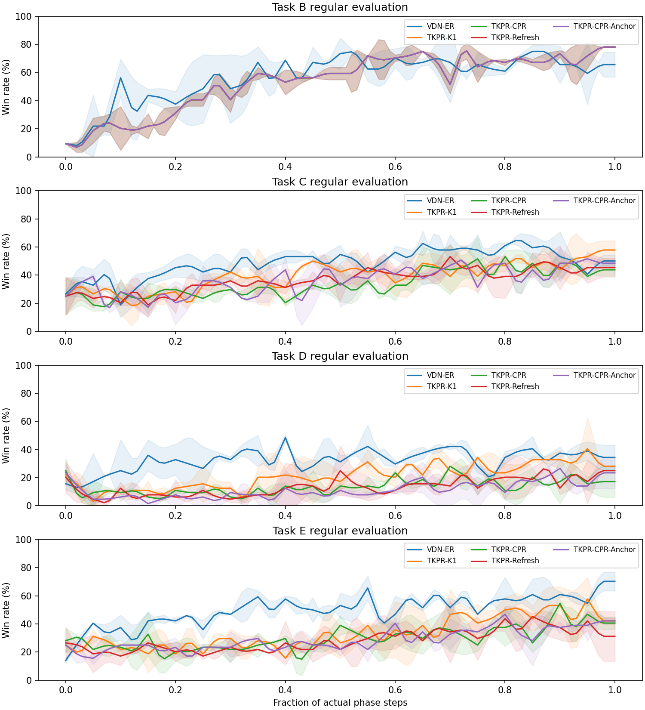
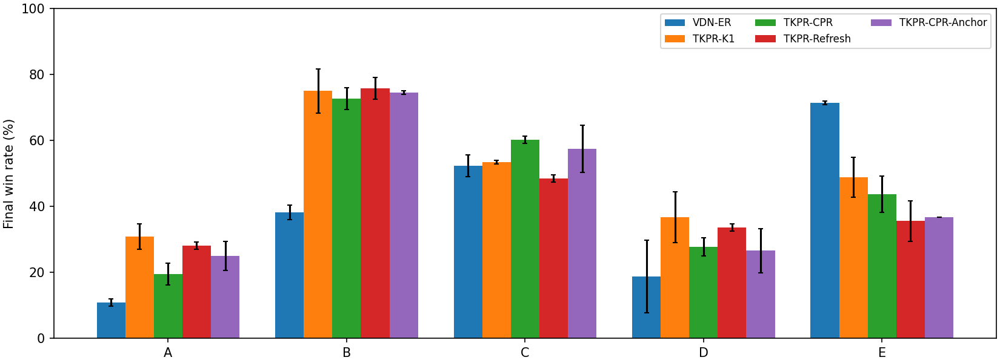
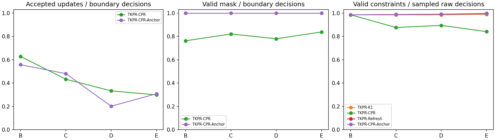

# TS5-1M · TKPR-CPR-Anchor 同前缀对照

**状态：两个 Anchor 分支训练、两个最终独立进程评价均完成；原四组只读复用。**

种子3535、2222，vdn_action_set + vdn_1ff，A→B→C→D→E。复用原实验对应种子的完整A前缀和相同A成功轨迹/Q；新增B–E各1M，两分支名义新增8M步。原四组34M步不重复训练。共同前缀在数据集中每种子只记录一次。

Anchor训练版本 `9ff065fb08ea91d6113f8f70383ade3f500a26e6`；原四组版本见 runs.csv。Anchor只在当前Top-1与永久原始Top-1一致、当前归一化置信度≥max(threshold,min_gap)、且严格高于已存参考置信度+margin时更新。未接受则保留原Q、掩码与来源。门控、K1损失、任务等权归约、总8条采样与原CPR相同；Refresh每历史任务8条。

每25k环境步32局regular评价，阶段末各已见任务128局。ACC任务等权；BWT相对各任务最近训练完成时表现；FWT相对共同初始模型的首次训练前表现。AUC只用phase_start/periodic的regular种子块梯形积分，末次值延伸至实际阶段末，再除以实际步数。两种子等权，SD为样本标准差；不能据两个种子作稳健显著性推断。

最终128局评价复用focus种子/index，是独立进程复核，不是独立测试集。空值保留缺失语义。

| 方法 | ACC均值±SD (%) | BWT均值±SD (pp) | FWT均值±SD (pp) |
| --- | ---: | ---: | ---: |
| VDN-ER | 38.36 ± 1.44 | -18.36 ± 0.28 | 16.99 ± 3.87 |
| TKPR-K1 | 48.98 ± 4.75 | 2.93 ± 2.21 | 17.38 ± 5.52 |
| TKPR-CPR | 44.77 ± 0.77 | 1.37 ± 4.70 | 19.04 ± 2.35 |
| TKPR-Refresh | 44.30 ± 0.11 | 3.81 ± 3.73 | 18.26 ± 2.62 |
| TKPR-CPR-Anchor | 44.06 ± 3.54 | 2.34 ± 4.14 | 16.70 ± 1.52 |

| 方法 | A | B | C | D | E |
| --- | ---: | ---: | ---: | ---: | ---: |
| VDN-ER | 10.94 ± 1.10 | 38.28 ± 2.21 | 52.34 ± 3.31 | 18.75 ± 11.05 | 71.48 ± 0.55 |
| TKPR-K1 | 30.86 ± 3.87 | 75.00 ± 6.63 | 53.52 ± 0.55 | 36.72 ± 7.73 | 48.83 ± 6.08 |
| TKPR-CPR | 19.53 ± 3.31 | 72.66 ± 3.31 | 60.16 ± 1.10 | 27.73 ± 2.76 | 43.75 ± 5.52 |
| TKPR-Refresh | 28.12 ± 1.10 | 75.78 ± 3.31 | 48.44 ± 1.10 | 33.59 ± 1.10 | 35.55 ± 6.08 |
| TKPR-CPR-Anchor | 25.00 ± 4.42 | 74.61 ± 0.55 | 57.42 ± 7.18 | 26.56 ± 6.63 | 36.72 ± 0.00 |

Anchor减对照，同种子配对（pp）：

| seed | 对照 | ΔACC | ΔBWT | ΔFWT |
| --- | --- | ---: | ---: | ---: |
| 3535 | VDN-ER | +2.19 | +17.97 | -4.10 |
| 3535 | TKPR-K1 | -10.78 | -5.08 | +2.15 |
| 3535 | TKPR-CPR | -3.75 | +1.37 | -1.76 |
| 3535 | TKPR-Refresh | -2.66 | -1.76 | -0.78 |
| 2222 | VDN-ER | +9.22 | +23.44 | +3.52 |
| 2222 | TKPR-K1 | +0.94 | +3.91 | -3.52 |
| 2222 | TKPR-CPR | +2.34 | +0.59 | -2.93 |
| 2222 | TKPR-Refresh | +2.19 | -1.17 | -2.34 |

机制图前两项按完整历史池真实决策数加权，包含门控失败任务；第三项为累计采样有效约束状态/掩码前真实决策（含重复采样）。状态掩码覆盖与min_gap筛后实际约束覆盖分开。逐任务、来源阶段、新旧置信度、梯度及开销见CSV。边界c的参考用于下一阶段；E末更新不能解释E阶段结果。Anchor门控通过时retained包含所有未更新状态，uncertain不新增屏蔽；门控失败沿用现有掩码计数，不改Q。

原始模型、Replay、轨迹和完整日志保留实验主机；原四组数据来自冻结的 [原报告](../ts5-tkpr-cpr-1m/README.md)，校验和见 source_manifest.json。本文仅描述配对性能与诊断，不把相关变化解释成性能原因。

复算：`python scripts/publish_ts5_cpr_anchor_1m.py --plan /home/wyh/marl_method_lab/results/ts5_tkpr_cpr_anchor_1m_20261126/plan.json --baseline docs/results/comparisons/ts5-tkpr-cpr-1m --output /tmp/ts5-anchor-reexport`。输出目录须尚不存在；脚本不训练、不修改原始运行或原四组结果。

## 结果解读与分阶段诊断

Anchor最终ACC 44.06±3.54%，相对原CPR平均−0.70pp；seed3535 −3.75pp、seed2222 +2.34pp，方向不一致。相对K1平均−4.92pp（−10.78/+0.94pp），相对Refresh平均−0.23pp，相对ER平均+5.70pp。没有一致超越原CPR或K1的证据。

最终A–D旧任务均值：Anchor 45.90%，原CPR 45.02%，K1 49.02%；最终E：Anchor 36.72%，原CPR 43.75%，K1 48.83%。Anchor相对原CPR在旧任务均值略高，但E学习更弱。按任务看，Anchor相对原CPR的A/B提高、C/D/E下降，不能把ACC变化一概归为遗忘。

| 方法 | B学习AUC | C学习AUC | D学习AUC | E学习AUC |
| --- | ---: | ---: | ---: | ---: |
| VDN-ER | 56.64 ± 7.73 | 48.65 ± 4.12 | 32.54 ± 4.86 | 50.04 ± 0.05 |
| TKPR-K1 | 53.63 ± 0.83 | 39.59 ± 5.72 | 20.98 ± 4.97 | 33.42 ± 7.16 |
| TKPR-CPR | 53.63 ± 0.83 | 33.91 ± 3.54 | 13.26 ± 2.68 | 29.84 ± 5.47 |
| TKPR-Refresh | 53.63 ± 0.83 | 36.42 ± 1.69 | 13.30 ± 4.00 | 28.22 ± 6.05 |
| TKPR-CPR-Anchor | 53.63 ± 0.83 | 36.27 ± 0.64 | 11.21 ± 4.14 | 28.65 ± 0.25 |

B阶段K1、CPR、Anchor和Refresh的regular学习曲线一致；首次参考更新发生在B末，差异从C阶段开始。Anchor的C阶段AUC高于原CPR，但D/E低于原CPR，D阶段也低于K1。这是学习效率差异，不能只根据最终保持率评价。

| 边界 | 方法 | 门控通过/任务点 | 更新比例 | 有效参考覆盖 | Top-1变化状态 |
| --- | --- | ---: | ---: | ---: | ---: |
| B | TKPR-CPR | 2/2 | 62.81% | 76.21% | 3129 |
| B | TKPR-CPR-Anchor | 2/2 | 55.73% | 100.00% | 0 |
| C | TKPR-CPR | 3/4 | 43.25% | 82.04% | 4415 |
| C | TKPR-CPR-Anchor | 4/4 | 48.02% | 100.00% | 0 |
| D | TKPR-CPR | 4/6 | 33.28% | 77.96% | 11175 |
| D | TKPR-CPR-Anchor | 3/6 | 20.11% | 100.00% | 0 |
| E | TKPR-CPR | 5/8 | 29.84% | 83.77% | 11414 |
| E | TKPR-CPR-Anchor | 7/8 | 30.80% | 100.00% | 0 |

Anchor在全部边界的uncertain状态数均为0，且有效掩码100%；这符合不新增屏蔽的规则。已接受更新的Top-1变化数为0，原CPR则可改变参考Top-1。Anchor仍更新Q值的归一化间隔和Pair筛选，不能据Top-1未变认定偏好目标完全静止。

| 方法 | C实际约束覆盖 | D实际约束覆盖 | E实际约束覆盖 |
| --- | ---: | ---: | ---: |
| TKPR-K1 | 98.41% | 98.49% | 98.88% |
| TKPR-CPR | 87.61% | 89.42% | 84.04% |
| TKPR-Refresh | 98.75% | 99.00% | 99.62% |
| TKPR-CPR-Anchor | 98.63% | 98.91% | 99.32% |

| 方法 | C梯度余弦均值 | D梯度余弦均值 | E梯度余弦均值 |
| --- | ---: | ---: | ---: |
| TKPR-K1 | 0.0634 | 0.0708 | 0.0848 |
| TKPR-CPR | 0.0724 | 0.0800 | 0.0824 |
| TKPR-Refresh | 0.0895 | 0.1072 | 0.1457 |
| TKPR-CPR-Anchor | 0.0695 | 0.0853 | 0.0900 |

梯度表是各运行监控点均值再按两个种子等权平均，不是不同checkpoint梯度向量的直接比较。完整范数、比值及运行内标准差见gradient_diagnostics.csv。更高约束覆盖并未转化成一致的性能优势；本次不能将原CPR的D/E下降完全解释为Top-1切换或uncertain屏蔽。锚定与不屏蔽是一起改变的，尚未单独分离二者作用。

## 发布前复核（2026-11-27）

调度器四项任务全部completed/exit 0；两个Anchor分支均完成5M累计阈值。新生成数据包含8个B–E阶段端点、10个最终128局复核点；与原四组及两个共同A合并后为12个训练运行、42个阶段端点、50个最终复核点。全部新阶段胜率、ACC/BWT/FWT已从胜局数独立重算，评价outcomes计数匹配；最终10点胜局数及seed/index集合均与阶段末一致。模型恢复及初始Memory指纹均匹配，启动commit均为9ff065f。三张图已检查。
