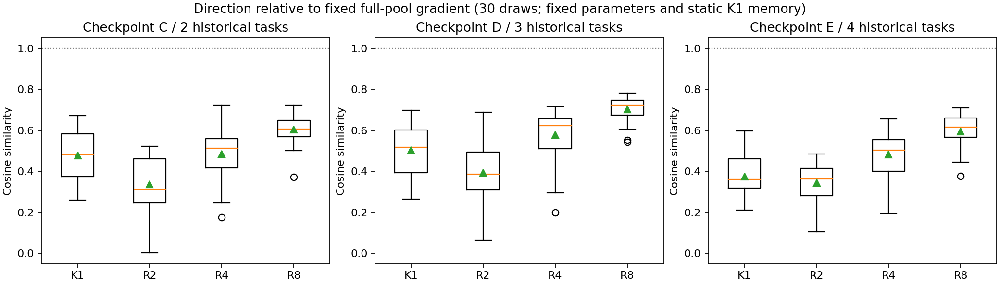
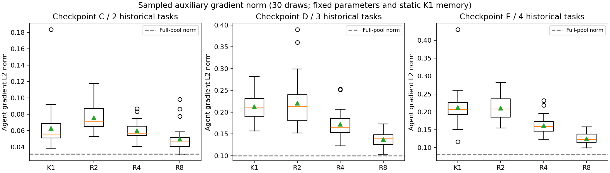
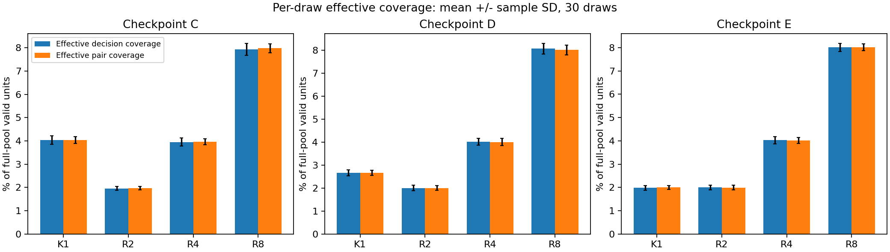

# TS5 TKPR 采样预算离线验证

**固定同一模型和原始静态历史池后，增加每任务采样量在本实验中降低了梯度向量方差，并改善平均方向；但每任务8条仍不是全量梯度的高精度替代。**

## 实验设计与兼容性

TS5 seed3535，使用 TKPR-K1 原始运行 `ts5_3535_tkpr_k1_20261122_attempt001`。选 C、D、E 阶段末模型，分别只回放此前 A/B、A/B/C、A/B/C/D 历史任务，排除当前任务。每任务100条静态成功轨迹，原始引用 checkpoint、完整序列及 old_q_values 均兼容；未使用 Refresh 已覆盖的历史池，也未混入轨迹刷新效果。

每个 checkpoint 内模型、历史池、TKPR-K1配置完全固定：weight=1、temperature=1、min_gap=0.5、q_scale_floor=0.1、k=1。只改变采样预算：K1调用 PreferenceHistory.sample，跨所有历史任务合计8条且按原实现随机均分；R2/R4/R8每任务分别2/4/8条。每方案30次；固定分析种子86431（不是新增训练种子），不同阶段使用独立SeedSequence；K1与Refresh预算用独立随机流。每次重复、每任务生成一个无放回8条清单，R2是前2条、R4前4条、R8全部8条，严格嵌套。各原池100条，无需有放回。

C阶段K1与R4同为每任务4条，E阶段K1与R2同为每任务2条，属于相同采样分布；独立随机流下30次样本的均值仍会不同，不把这种差异解释成方法效果。D阶段K1随机分配3/3/2条。全部保存 episode_ids，方便核对嵌套与分配。

来源路径、SHA-256、分析基版本与运行版本、随机种子、依赖版本和可训练Agent参数列表见 [input_manifest.json](input_manifest.json)。模型路径分别为原运行 `models/phase0002_6000067/agent.th`、`phase0003_8000011/agent.th`、`phase0004_10000031/agent.th`；Memory为 `action_set_memory/phase0000` 到 `phase0003/success.th`。训练版本为 `9db0ed1951ded62c00eb1ff27a80c71ae5465dc5`，分析基版本为 `9a9b9faa4750c8731b9a09d0a7cc773daf3df2bf`。

分析在本机CPU、两线程、PyTorch 2.6.0、NumPy 1.26.4 上完成；输入副本与远端原件SHA-256核对。没有环境实例化、在线采样、optimizer.step或输入文件写入。360次联合梯度检查和参数不变检查全部通过，结束后再次验证输入文件哈希不变。

## 损失、参考梯度与统计定义

- **每任务全量参考**：直接调用仓库 RankingPreference.task_loss，一次使用该任务全部100条完整序列与存储old_q_values；每个模型独立从零恢复RNN隐状态，保留历史动作输入。合法动作、alive/filled/terminated过滤、Q归一化、温度、min_gap和状态内Pair均值沿用真实实现。
- **跨任务聚合**：调用原 ActionSetPreference.reduce_task_losses，先各任务有效状态平均，再对有约束任务等权平均。全量参考先分别计算全池任务梯度，再使用原归约函数的自动微分权重合成；没有合并所有任务Pair平均。采样时直接对原归约函数返回的联合损失求导，并核对它等于任务梯度的有效任务加权和。
- **参数范围**：与 preference_grad_norm_agent 一致，为 agent.parameters() 中requires_grad参数；autograd.grad计算，未用optimizer。梯度向量转float64后求范数、距离和余弦。
- **相对误差**：||g_sample−g_full||₂/||g_full||₂。余弦是同一checkpoint、同一scope的采样梯度与全量梯度比较，绝不混合不同参数位置。
- **向量方差**：trace(Cov(g)) = Σ||g_r−mean(g)||²/(30−1)；normalized_gradient_variance_trace再除以||g_full||²。另给相对偏差||mean(g)−g_full||/||g_full||和相对误差平方均值；这比仅看范数SD更能判断估计稳定性。范数的标准差不必随预算单调降低；这里的相对偏差仅是30次经验均值相对参考的偏移，不能当成已证明的总体估计偏差。
- **覆盖**：有效状态指至少一个有效TKPR Pair的智能体决策，有效Pair为这些决策内通过合法动作、Top-K及min_gap筛选的Pair计数。state/pair_coverage_of_full是单次采样有效单位数/同任务（或全历史任务）全池有效单位数。每任务无放回，单次没有重复轨迹计数；不是30次采样并集覆盖率或环境空间覆盖率。
- **任务参与**：单任务有有效状态记1，否则0；ALL为当次有约束任务比例。no_valid_constraint_fraction为其补值。每个任务独立行与汇总均保存，不用ALL行替代任务差异。所有SD使用样本SD（ddof=1）。

## 联合辅助梯度结果

| checkpoint | 预算 | 总轨迹数 | 范数均值±SD | 对全量cosine均值±SD | 相对误差均值 | 归一化向量方差 |
| --- | --- | ---: | ---: | ---: | ---: | ---: |
| C | K1 | 8 | 0.0629 ± 0.0259 | 0.477 ± 0.123 | 1.781 | 3.696 |
| C | Refresh-2 | 4 | 0.0755 ± 0.0164 | 0.337 ± 0.141 | 2.277 | 5.260 |
| C | Refresh-4 | 8 | 0.0600 ± 0.0107 | 0.484 ± 0.116 | 1.677 | 2.825 |
| C | Refresh-8 | 16 | 0.0496 ± 0.0147 | 0.605 ± 0.074 | 1.279 | 1.778 |
| D | K1 | 8 | 0.2124 ± 0.0329 | 0.504 ± 0.126 | 1.842 | 3.472 |
| D | Refresh-2 | 6 | 0.2206 ± 0.0556 | 0.395 ± 0.147 | 2.043 | 4.421 |
| D | Refresh-4 | 12 | 0.1719 ± 0.0303 | 0.579 ± 0.119 | 1.408 | 2.049 |
| D | Refresh-8 | 24 | 0.1375 ± 0.0176 | 0.702 ± 0.064 | 0.988 | 0.982 |
| E | K1 | 8 | 0.2124 ± 0.0505 | 0.376 ± 0.097 | 2.434 | 6.268 |
| E | Refresh-2 | 8 | 0.2108 ± 0.0328 | 0.346 ± 0.087 | 2.444 | 6.113 |
| E | Refresh-4 | 16 | 0.1611 ± 0.0244 | 0.482 ± 0.121 | 1.742 | 3.135 |
| E | Refresh-8 | 32 | 0.1250 ± 0.0136 | 0.595 ± 0.089 | 1.241 | 1.574 |





## 有效约束覆盖与任务参与

| checkpoint | 预算 | 有效状态均值 | 有效Pair均值 | 状态全池覆盖率 | Pair全池覆盖率 | 有效任务参与率 | 无有效约束任务比例 |
| --- | --- | ---: | ---: | ---: | ---: | ---: | ---: |
| C | K1 | 1940.9 | 8561.6 | 4.03% | 4.03% | 100% | 0% |
| C | Refresh-2 | 942.1 | 4174.8 | 1.96% | 1.97% | 100% | 0% |
| C | Refresh-4 | 1900.9 | 8407.6 | 3.95% | 3.96% | 100% | 0% |
| C | Refresh-8 | 3817.4 | 16930.0 | 7.93% | 7.98% | 100% | 0% |
| D | K1 | 2157.3 | 8928.2 | 2.66% | 2.66% | 100% | 0% |
| D | Refresh-2 | 1624.6 | 6718.2 | 2.00% | 2.00% | 100% | 0% |
| D | Refresh-4 | 3258.4 | 13435.8 | 4.02% | 4.01% | 100% | 0% |
| D | Refresh-8 | 6541.4 | 26874.7 | 8.07% | 8.01% | 100% | 0% |
| E | K1 | 2142.1 | 9286.7 | 1.98% | 2.00% | 100% | 0% |
| E | Refresh-2 | 2164.5 | 9272.4 | 2.00% | 2.00% | 100% | 0% |
| E | Refresh-4 | 4351.0 | 18656.9 | 4.03% | 4.01% | 100% | 0% |
| E | Refresh-8 | 8654.9 | 37242.2 | 8.01% | 8.01% | 100% | 0% |



## 保留各历史任务的独立结果

下表给K1与R8各历史任务的方向和误差对照；所有四档预算的任务级范数、覆盖及参与率见 sampling_budget_summary.csv。

| checkpoint | 历史任务 | K1 cosine | R8 cosine | K1相对误差 | R8相对误差 |
| --- | --- | ---: | ---: | ---: | ---: |
| C | A | 0.353 | 0.544 | 1.742 | 1.298 |
| C | B | 0.452 | 0.584 | 2.042 | 1.418 |
| D | A | 0.314 | 0.492 | 2.899 | 1.560 |
| D | B | 0.336 | 0.531 | 2.858 | 1.477 |
| D | C | 0.547 | 0.740 | 1.591 | 0.908 |
| E | A | 0.272 | 0.542 | 2.479 | 1.484 |
| E | B | 0.318 | 0.579 | 2.484 | 1.358 |
| E | C | 0.286 | 0.495 | 3.488 | 1.636 |
| E | D | 0.285 | 0.487 | 3.113 | 1.584 |

## 嵌套预算的方向变化

每一行只比较同一次重复、同一checkpoint的两个采样梯度；角度由arccos(cosine)转换。最后一列是增加预算后对全量参考的cosine反而下降的比例，不能用平均趋势掩盖这些单次变化。

| checkpoint | 嵌套比较 | 梯度间夹角均值±SD | 最大夹角 | 对全量cosine下降比例 |
| --- | --- | ---: | ---: | ---: |
| C | Refresh-2→Refresh-4 | 44.6° ± 7.5° | 60.2° | 6.7% |
| C | Refresh-4→Refresh-8 | 40.7° ± 10.8° | 66.8° | 10.0% |
| C | Refresh-2→Refresh-8 | 58.4° ± 9.1° | 74.8° | 3.3% |
| D | Refresh-2→Refresh-4 | 41.4° ± 7.0° | 51.8° | 0.0% |
| D | Refresh-4→Refresh-8 | 37.0° ± 6.4° | 52.6° | 0.0% |
| D | Refresh-2→Refresh-8 | 54.3° ± 8.1° | 70.9° | 0.0% |
| E | Refresh-2→Refresh-4 | 42.7° ± 9.5° | 70.5° | 3.3% |
| E | Refresh-4→Refresh-8 | 39.6° ± 5.6° | 52.1° | 6.7% |
| E | Refresh-2→Refresh-8 | 55.5° ± 6.6° | 77.6° | 3.3% |

## 对重点问题的回答

1. **增加采样量是否降低估计方差？** 在这三个固定checkpoint/静态池上，R2→R4→R8的联合梯度向量方差逐档降低。R8相对K1的归一化向量方差在C/D/E约降低52%/72%/75%。单个范数SD不保证单调，例如C的R8范数SD高于R4；不能把范数SD等同向量方差。
2. **小预算方向是否已代表全量梯度？** 只能提供部分代表性。K1联合余弦约0.38–0.50，相对误差约1.78–2.43；R8改善后仍只有0.60–0.70，相对误差约0.99–1.28。没有据此设定任意通过门槛，也不能称其高精度复现全量方向。
3. **每任务8条是否提供更有效信息？** 本静态对照中是：比总8条增加有效状态与Pair覆盖，同时平均余弦提高、相对误差及向量方差降低。但所有方案任务参与率都为100%，不能声称它解决了本数据中的历史任务未参与问题；也未计算单位时间的信息效率。
4. **是否只是覆盖增加？** 不只是计数增加，方向与误差指标也改善。覆盖与方向并非同一指标：原目标按任务有效状态和有效任务平均，不能把Pair数倍增解释成梯度范数倍增。
5. **增加预算会否明显改变方向，甚至更远离全量？** 会。嵌套比较夹角及单次余弦下降比例已逐阶段列出；平均改善不保证每次采样改善。这种变化表明新增轨迹带来不同梯度贡献，不足以解释为有害梯度或训练效果恶化。

## 解释边界与文件

这是单训练种子、单序列、原始K1静态记忆池上的离线预算对照。30次采样不是30个训练种子；统计SD衡量固定模型/池上的采样波动。结果不证明改用大预算会提高在线胜率，也不解释TKPR-Refresh的D/E下降：真正Refresh同时改变历史轨迹内容和参考目标，历史真实池又已被覆盖。本实验刻意固定这些变量，仅检查采样预算。全量经验池本身是有限样本基准，不是总体环境分布的真实梯度。

- sampling_budget.csv：每次采样、每个任务及ALL的原始指标和索引。
- sampling_budget_summary.csv：各档预算/任务均值SD、完整向量方差、相对偏差与MSE。
- full_pool_reference.csv：全量基准的任务loss、梯度范数、有效状态和Pair数。
- paired_directions.csv：同次抽样方案之间方向变化。
- verification_checks.csv：360次原任务归约梯度一致性、模型不变与嵌套标记。
- input_manifest.json：输入文件路径和校验和、Git版本与依赖。

复现（原始输入在Ubuntu运行目录，亦可使用校验一致的本机副本）：

```sh
PYTHONPATH=src:. python docs/results/comparisons/ts5-tkpr-refresh/analysis/sampling_budget/analyze_sampling_budget.py --repo . --seed 86431 --repeats 30
python docs/results/comparisons/ts5-tkpr-refresh/analysis/sampling_budget/render_sampling_budget.py
```

依赖PyTorch、NumPy、PyYAML、Matplotlib；跨PyTorch版本不保证逐位一致。原始checkpoint、Memory和训练配置从未修改。
