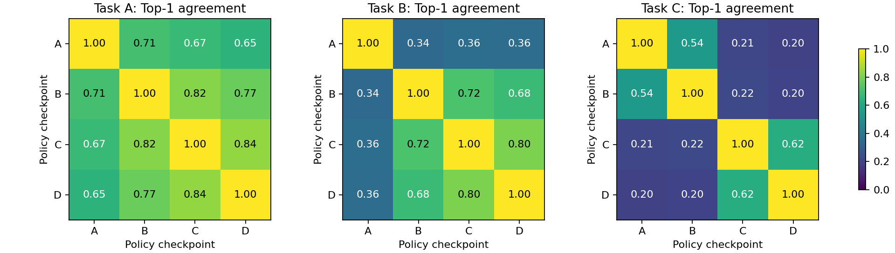
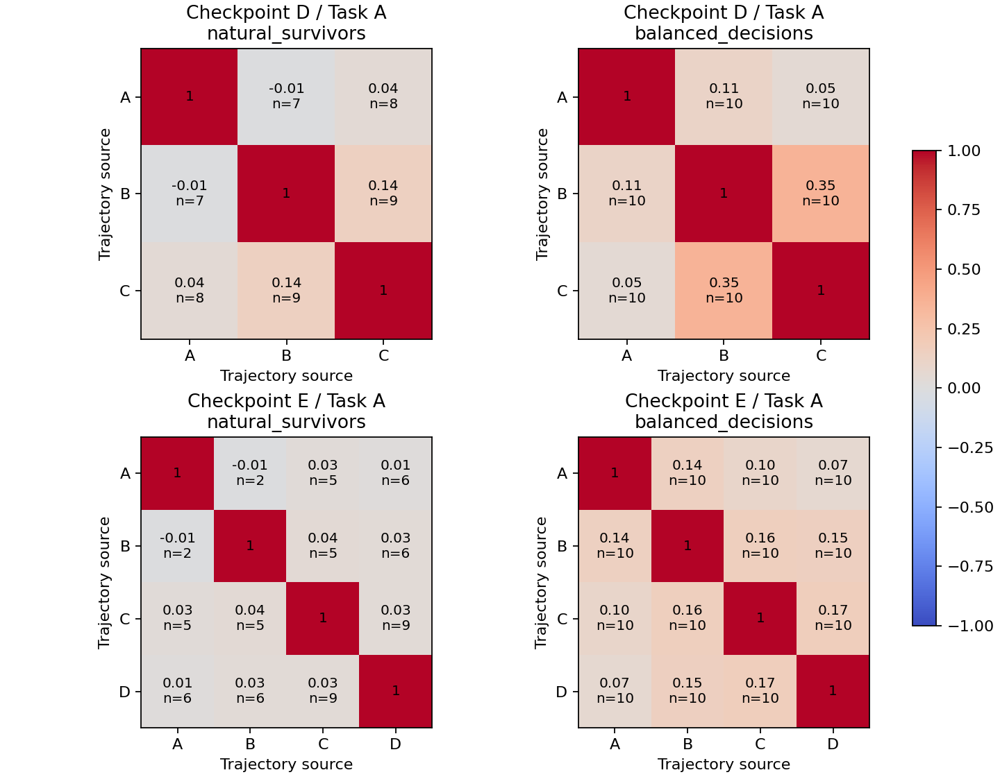
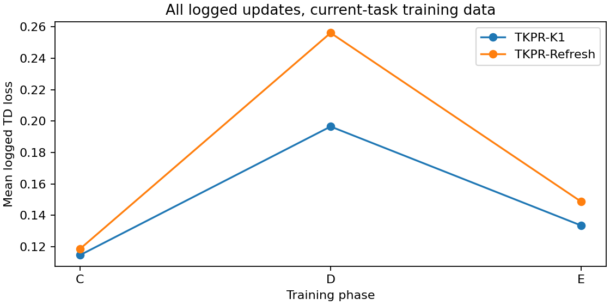

# TKPR-Refresh：轨迹来源与参考排序漂移离线分析

TS5，训练 seed 3535。仅使用已保存产物，未重新训练、启动 SMAC 或执行新策略采样。

**证据边界：Refresh 的各阶段历史池已原地覆盖，真实 D/E 训练池与同次 TD minibatch 不可恢复。梯度结果是最终池留存旧来源的离线探测，不是原训练更新的重放。** 详见 [数据审计](data_audit.md)。

## 1. 输入与统计口径

- 28份输入校验和已与Ubuntu原始文件一致，500条Refresh来源路径与阶段匹配，13个损失/掩码/梯度函数AST与训练版本一致；复查用 verify_inputs.py。
- 两方法各五个阶段末 checkpoint 可读，无阶段内 25/50/75% checkpoint。训练版本为 `9db0ed1951ded62c00eb1ff27a80c71ae5465dc5`。分析运行版本、Python/PyTorch/NumPy 与输入 SHA-256 见 [manifest](input_manifest.json)。本机 CPU / PyTorch 2.6.0，与训练 CPU rollout PyTorch 1.12.1 不同。
- 每方法/任务/来源抽查一条完整序列，共 20 条，来源模型重新展开 Q 的最大绝对差 5.72e-05。固定的绝对误差参考线 2e-5 并非全部满足，详细数值如实保留；跨版本/后端可能贡献误差，未据此覆盖保存 Q，亦不能宣称逐位完全一致。轨迹字段、时间轴和有限值检查通过。
- Refresh 来源只取逐轨迹 reference_phase，checkpoint 路径与阶段对应关系经审计；pool phase 仅表示池首次创建阶段。K1 的静态池来源依据采集代码与池级 checkpoint。
- 固定状态面板：A/B/C 各包含 K1 原池 4 条及 Refresh 各来源最多4条完整轨迹，分别24/20/16条。两方法的所有 A–D 模型读取完全相同的面板；每次独立从零隐状态完整展开其自己的 RNN，使用记录中的历史动作输入。包含后来来源的状态用于回溯评估，不代表当时在线分布；选择信息见 fixed_panel.csv。
- Top-1 并列时取最小合法动作索引；只统计 alive、filled、终止前且至少两个合法动作的决策。Kendall tau-b 在每决策合法动作内计算后等权平均，保留精确同值，分母为0的决策剔除。Pairwise Ranking Agreement 对所有合法无序动作对汇总 sign(gap) 相等比例（含双同值）；同值与严格排序不算一致。
- Normalized Q-gap = (合法Top1 Q − Top2 Q) / max(合法Q总体标准差, 0.1)，每模型独立归一化；同时给 gap 绝对变化和旧模型对新贪婪动作的归一化 regret。
- 来源分布统计独立于排序实验：trajectory_source_stats.csv 给最终池各来源数量、长度均值/标准差、有效决策数量、动作频数。coverage 是 obs 四舍五入3位后的独有行数/有效决策数量，仅为记录覆盖代理，不是全环境状态覆盖；source_distribution_distances.csv 给动作频率 JS 散度，不能单凭它推断排序漂移。

## 2. 同一状态上的参考排序变化

Refresh 初始任务参考模型对比 D 末模型（最新纳入的参考模型）：

| 历史任务 | 模型阶段 | Top-1一致率 | tau-b | 成对一致率 | 归一化gap绝对变化 |
| --- | --- | ---: | ---: | ---: | ---: |
| A | A→D | 0.646 | 0.560 | 0.783 | 0.659 |
| B | B→D | 0.680 | 0.544 | 0.771 | 0.596 |
| C | C→D | 0.621 | 0.596 | 0.792 | 0.583 |

最终池各来源轨迹数量（pool phase不参与来源推断）：

| 方法 | 历史任务 | 来源阶段:轨迹数 | 各来源平均长度范围 |
| --- | --- | --- | ---: |
| tkpr_k1 | A | A:100 | 64.5–64.5 |
| tkpr_k1 | B | B:100 | 61.6–61.6 |
| tkpr_k1 | C | C:100 | 89.5–89.5 |
| tkpr_k1 | D | D:100 | 71.9–71.9 |
| tkpr_k1 | E | E:100 | 74.7–74.7 |
| tkpr_refresh | A | A:7, B:7, C:12, D:24, E:50 | 61.9–64.6 |
| tkpr_refresh | B | B:15, C:15, D:20, E:50 | 58.9–62.1 |
| tkpr_refresh | C | C:27, D:23, E:50 | 83.6–91.4 |
| tkpr_refresh | D | D:50, E:50 | 72.8–78.9 |
| tkpr_refresh | E | E:100 | 76.9–76.9 |



所有阶段对与 K1 策略对照均见 reference_rank_drift.csv。固定状态上的排序确有变化，这证明策略的输出参考可能改变；不是根据不同来源轨迹分布倒推的。K1 自身策略也会变化，但其存储约束目标保持原始模型 Q；Refresh 改变新增轨迹的参考策略。当前数据不足以逐状态追踪“某条原池轨迹被刷新后其目标如何改变”，因为替换的是轨迹本身且旧池快照缺失。

## 3. 来源梯度冲突与数值还原

C/D/E 阶段末模型分别独立分析，只用早于该训练阶段的来源及旧任务：C用A/B；D用A/B/C；E用A/B/C/D。Refresh 最终池按 reference_phase < checkpoint phase 筛选后，是有幸存偏差的旧来源集合，不能视为原来的完整历史池。未直接比较不同模型位置的梯度。

每模型位置、每设置10次独立抽样。natural_survivors 从该留存子集均匀采8条完整轨迹，来源份额由抽到的轨迹自然决定；不是已经缺失的原始池自然分布。K1 自然设置保持跨历史任务总预算8条与原始随机均分方式。balanced_decisions 每来源采8条完整序列，计算真实 TKPR 有效状态后，各来源随机保留相同数量的损失决策；完整序列及隐状态展开均保留，只对损失决策掩码做条件化筛选。此设置减少数量差异，同时改变状态选择，不能等同真实训练采样。

调用仓库 topk_preference，复用合法动作、min_gap=0.5、Q尺度下限0.1、温度1、k=1和状态/动作对归约。先算完整任务损失与 g，再按来源计算 L_s、g_s，权重 w_s = N_s / ΣN_s，其中 N_s 是有至少一个有效动作对的决策数，**不是轨迹数占比**。实际辅助贡献为 λ/H × w_s g_s（λ=1，H为该设置有约束历史任务数）；原始任务损失为 Σ w_s L_s。梯度范围为 agent.parameters() 中 requires_grad 参数，使用 autograd.grad，按 float64 展平范数与余弦，与 preference_grad_norm_agent 一致。没有 optimizer.step。
全部 360 个任务/抽样的重构通过：max|Σw_s g_s−g|最大 8.79e-08，相对L2误差最大 2.31e-06。固定验收条件是绝对误差≤2e-6或相对误差≤2e-5；未放宽阈值。详见 gradient_reconstruction.csv。

每抽样源未出现或零有效梯度时，余弦记缺失，不能记零；cosine_n 是10次中的可定义数，负余弦比例仅以可定义项为分母。标准差用 ddof=1；逐次数据和汇总均保留。K1 每任务只有一个参考来源，因此没有可定义的同任务跨来源矩阵。加权贡献还提供其在完整任务梯度上的投影比例；范数不可直接相加。

Task A 的 D/E 来源矩阵（颜色为10次内可定义余弦均值，n为有效次数）：



| checkpoint | task | 设置 | 来源对 | cosine均值±样本SD | 有效次数/10 | 负余弦比例 |
| --- | --- | --- | --- | ---: | ---: | ---: |
| D | A | natural_survivors | A/B | -0.010 ± 0.171 | 7/10 | 71.4% |
| D | A | natural_survivors | A/C | 0.044 ± 0.156 | 8/10 | 50.0% |
| D | A | natural_survivors | B/C | 0.143 ± 0.143 | 9/10 | 11.1% |
| D | B | natural_survivors | B/C | 0.533 ± 0.086 | 10/10 | 0.0% |
| D | A | balanced_decisions | A/B | 0.109 ± 0.103 | 10/10 | 0.0% |
| D | A | balanced_decisions | A/C | 0.048 ± 0.151 | 10/10 | 50.0% |
| D | A | balanced_decisions | B/C | 0.352 ± 0.069 | 10/10 | 0.0% |
| D | B | balanced_decisions | B/C | 0.654 ± 0.054 | 10/10 | 0.0% |
| E | A | natural_survivors | A/B | -0.014 ± 0.041 | 2/10 | 50.0% |
| E | A | natural_survivors | A/C | 0.029 ± 0.137 | 5/10 | 40.0% |
| E | A | natural_survivors | A/D | 0.011 ± 0.114 | 6/10 | 50.0% |
| E | A | natural_survivors | B/C | 0.044 ± 0.124 | 5/10 | 20.0% |
| E | A | natural_survivors | B/D | 0.033 ± 0.148 | 6/10 | 50.0% |
| E | A | natural_survivors | C/D | 0.034 ± 0.135 | 9/10 | 22.2% |
| E | B | natural_survivors | B/C | 0.163 ± 0.130 | 8/10 | 12.5% |
| E | B | natural_survivors | B/D | 0.060 ± 0.102 | 9/10 | 22.2% |
| E | B | natural_survivors | C/D | 0.056 ± 0.110 | 9/10 | 33.3% |
| E | C | natural_survivors | C/D | 0.026 ± 0.166 | 10/10 | 30.0% |
| E | A | balanced_decisions | A/B | 0.141 ± 0.089 | 10/10 | 0.0% |
| E | A | balanced_decisions | A/C | 0.100 ± 0.103 | 10/10 | 20.0% |
| E | A | balanced_decisions | A/D | 0.069 ± 0.099 | 10/10 | 20.0% |
| E | A | balanced_decisions | B/C | 0.161 ± 0.126 | 10/10 | 10.0% |
| E | A | balanced_decisions | B/D | 0.154 ± 0.164 | 10/10 | 20.0% |
| E | A | balanced_decisions | C/D | 0.169 ± 0.139 | 10/10 | 10.0% |
| E | B | balanced_decisions | B/C | 0.179 ± 0.110 | 10/10 | 0.0% |
| E | B | balanced_decisions | B/D | 0.161 ± 0.087 | 10/10 | 0.0% |
| E | B | balanced_decisions | C/D | 0.160 ± 0.073 | 10/10 | 0.0% |
| E | C | balanced_decisions | C/D | 0.141 ± 0.118 | 10/10 | 10.0% |

观测到部分抽样下新旧来源梯度方向冲突；来源对之间差异明显。等量控制后的均值大多为正，但仍有负余弦样本（例如 D末/A任务的A–C来源对50%）。自然设置中某些旧来源有效次数很少，例如 E末/A任务A–B对仅2次；不把这种高方差结果解释为稳定的训练规律。来源分组同时改变轨迹状态、行为历史及参考Q，负余弦不能单独归因于参考目标漂移。

## 4. TD 关系与训练日志

source_td_gradient.csv 为明确不可用记录。没有当前任务 TD minibatch 与同次参数位置，未用成功轨迹或其他阶段数据代替。已公布的聚合 preference–TD cosine 无来源拆分，不能填补本项。

| 阶段 | K1 TD均值 | Refresh TD均值 | 相对变化 | K1中位数 | Refresh中位数 |
| --- | ---: | ---: | ---: | ---: | ---: |
| C | 0.11464 | 0.11859 | +3.4% | 0.09828 | 0.10333 |
| D | 0.19649 | 0.25609 | +30.3% | 0.17216 | 0.19183 |
| E | 0.13347 | 0.14863 | +11.4% | 0.12456 | 0.13851 |



TD Loss 取原始 updates JSONL 每次更新的 td_loss（masked TD MSE），并以该运行实际阶段起止环境步分成四个进度段；不是 gradient_monitor 子样本。逐阶段与四分段的 n/mean/median/sample SD 全见 td_loss_by_phase.csv。两组来自不同策略、状态经验和目标网络，较大TD Loss不直接等于学习能力较差，也不构成性能差异的因果解释。

## 5. 对五个问题的回答

1. **参考动作排序是否变化：是。** 同一固定完整轨迹上，Refresh 初始参考策略与D末策略的Top1一致率约62%–68%；K1策略也变化，但其历史参考目标固定。
2. **新旧来源有无梯度冲突：部分抽样存在。** 数值拆分已校验；自然与等量设置下冲突比例不同。缺失真实历史池使结果只适用于留存样本探测。
3. **新来源是否更符合当前TD：无法验证。** 缺少同checkpoint/同更新TD minibatch；不从来源间余弦或TD Loss替代推断。
4. **参考目标漂移可能削弱知识保护吗：机制上可能，尚未建立因果。** 新策略生成的新轨迹携带不同参考排序，旧策略目标的覆盖也因替换减少；但状态分布变化、每任务采样预算变化、新任务本身的学习差异都是竞争解释。
5. **是否足以解释D/E下降：不足。** 固定状态排名变化、部分来源冲突与更高TD Loss是可验证现象；缺少训练时真实池、阶段内checkpoint及同次TD数据，无法证明它们导致Refresh在D/E的ACC下降。重复抽样不增加训练种子数量。

## 复现与文件

从仓库根目录执行（原始输入在实验主机，亦可使用按 manifest 校验过的只读副本）：

```sh
PYTHONPATH=src:. python docs/results/comparisons/ts5-tkpr-refresh/analysis/source_drift/analyze_source_drift.py --repo .
python docs/results/comparisons/ts5-tkpr-refresh/analysis/source_drift/render_report.py
```

依赖 Python、PyTorch、NumPy、PyYAML 与 Matplotlib。分析随机种子68121，CPU两线程；跨PyTorch版本重现不保证逐位相同。必要输入位置/SHA-256见 manifest，固定状态面板含序列hash。原始模型/轨迹/日志不上传本目录。所有 CSV 的 phase 为0起始，A=0…E=4。空格表示不可用；`source_gradient_metrics.csv`、`source_gradient_cosine.csv` 是逐次记录，相应 summary 文件给均值/标准差及有效次数。
