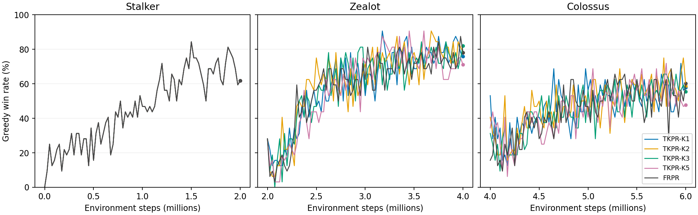

# SZC TKPR K 值消融

五组共 5/5 条训练与终态汇总均正常退出，合计 30,000,185 环境步。五组均为 seed 1111、双层 VDN64、SMACv2 镜像 5v5 S→Z→C、每阶段名义 2M、逐任务 ε、FT 回放，启动提交均为 `f332d9e`。阶段末每个已见任务独立贪心评价 128 局。 [运行清单与配置](runs.csv)

五组 S 阶段各更新只使用 TD 损失，均在 2,000,051 步达到 61.72% 胜率，Agent 参数指纹一致。偏好约束自 Z 阶段开始，公共权重、温度、最小归一化间隔和 Q 尺度下限分别为 1.0、1.0、0.5 和 0.1。

## 阶段末表现

每个阶段按 S、Z、C 顺序列出已见任务胜率。ACC 为 C 末三任务平均胜率；ΔACC、BWT 和 FWT 的单位为百分点。

| 方法 | S 末（%） | Z 末（%） | C 末（%） | 最终 ACC（%） | ΔACC 对 FRPR | BWT | FWT |
| --- | ---: | --- | --- | ---: | ---: | ---: | ---: |
| TKPR-K1 | 61.72 | 60.16 / 75.78 | 61.72 / 82.81 / 57.81 | 67.45 | +1.56 | +3.52 | +38.67 |
| TKPR-K2 | 61.72 | 58.59 / 78.12 | 52.34 / 81.25 / 58.59 | 64.06 | -1.82 | -3.12 | +37.11 |
| TKPR-K3 | 61.72 | 57.81 / 82.03 | 66.41 / 79.69 / 55.47 | 67.19 | +1.30 | +1.17 | +29.30 |
| TKPR-K5 | 61.72 | 57.81 / 71.09 | 55.47 / 68.75 / 47.66 | 57.29 | -8.59 | -4.30 | +32.03 |
| FRPR | 61.72 | 57.03 / 78.12 | 58.59 / 78.91 / 60.16 | 65.89 | — | -1.17 | +29.30 |

K1 和 K3 的最终 ACC 接近，分别比 FRPR 高 1.56 和 1.30 个百分点。K3 保留的 S 胜率最高（66.41%），K1 的 Z 胜率最高（82.81%），FRPR 的 C 胜率最高（60.16%）。K5 比 FRPR 低 8.59 个百分点，主要差距在 Z 和 C。

## 当前任务学习曲线

圆点标记阶段末评估。横轴是累计环境步。阶段内定期评估为 32 局，阶段末为 128 局。

## 实际有效 K 和 Agent 梯度

有效 K 分布按所有更新中筛选后至少有一对有效排序约束的智能体决策汇总，重复采样的决策按出现次数计。动作对数为有效动作对总数除以有效状态总数。梯度比为加权偏好梯度与 TD 梯度范数之比的中位数，每 100 次更新采样一次，统计裁剪前的 Agent 梯度。

| 方法 | 有效动作对/状态 Z／C | 实际 K 达到配置值 Z／C（%） | 梯度比中位数 Z／C（%） | 梯度余弦中位数 Z／C |
| --- | ---: | ---: | ---: | ---: |
| TKPR-K1 | 4.47 / 4.41 | 100.0000 / 100.0000 | 4.23 / 10.44 | 0.113 / 0.069 |
| TKPR-K2 | 7.34 / 7.17 | 100.0000 / 100.0000 | 5.32 / 13.92 | 0.125 / 0.090 |
| TKPR-K3 | 9.20 / 8.76 | 99.9404 / 99.9022 | 5.79 / 15.44 | 0.129 / 0.086 |
| TKPR-K5 | 11.16 / 10.72 | 80.7123 / 74.9169 | 6.81 / 18.36 | 0.136 / 0.101 |
| FRPR | 11.76 / 11.29 | — | 6.94 / 17.90 | 0.138 / 0.093 |

K5 在 Z、C 阶段分别有约 19.29%、25.08% 的有效决策被截断到小于 5，主要截断为 4。K 从 1 增到 5 时，每个有效状态的动作对数递增，梯度比的中位数也递增。C 阶段 K5 的梯度比为 18.36%，接近 FRPR 的 17.90%。各组在 Z/C 阶段的梯度余弦中位数均为正，负余弦样本比例约 3.5%–13.4%。本轮只有 seed 1111，无法确定 K1 与 K3 的稳定排序，也无法把 K5 的下降归因于梯度模长或方向。

[阶段指标 CSV](stage_metrics.csv) · [逐次评估 CSV](evaluations.csv) · [按历史任务汇总的偏好诊断](preference_diagnostics.csv) · [有效 K 计数与梯度汇总](mechanism_summary.json)
