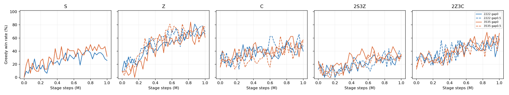

# TS5-1M · 原生 TKPR-K1 Gap 消融

原生 `topk_preference(k=1)`，min_gap=0/0.5 × seed2222/3535，仅四条新增训练。禁止使用的 pair_tc_k1 未参与此实验。两种 gap 复用同种子原 FT 参考的 S 检查点（在线网络、目标网络、优化器和 RNG）以及完整 S/Z/C/D 历史轨迹与 rollout-stored old Q；不重新训练参考模型。
任务为 S→Z→C→2S3Z→2Z3C，各阶段1M；单层 VDN64、FT、逐任务 epsilon、RMSprop、lr=0.0005、偏好权重1、temperature1、old-Q std floor0.1、历史batch8、评价种子与局数均沿用原实验。分支新增 Z/C/D/E 约4M步，总新增名义16M；S 前缀每种子只训练过一次。
没有 TC 有效状态筛选、Near/Mid/Far 配额或额外边。完整历史池逐阶段接入，训练Z仅见S，C见S/Z，D见S/Z/C，E见S/Z/C/D。仅原生合法/存活/终止掩码、至少两个合法动作及非零 old-Q pair 定义参与原生损失。gap0保留全部原生K1合法非并列动作对；gap0.5仅额外要求绝对归一化历史Q差>=0.5。未通过间隔的动作对不产生偏好损失；零动作对状态与整条轨迹仍留在历史池，RNN仍按完整时序重放。
正常 `src/learners/ranking_preference.py` 与 QLearner 的损失和优化代码未改变。新增功能仅为原检查点兼容和按阶段复制固定历史池，运行记录确认 RankingPreference 调用原生 topk_preference。

完成训练：4/4；终态核验通过：4；阶段指标：20；独立模型×任务终点评价：20。

| Seed | gap | ACC % | BWT pp | FWT pp | E AUC % |
|---|---:|---:|---:|---:|---:|
| 2222 | 0 | 50.313 | 7.422 | 16.797 | 38.691 |
| 2222 | 0.5 | 56.094 | 11.719 | 20.117 | 42.087 |
| 3535 | 0 | 54.375 | 4.883 | 22.461 | 40.683 |
| 3535 | 0.5 | 53.906 | 2.539 | 17.773 | 37.821 |

最终 ACC 的 gap0.5−gap0 逐种子差值：seed2222 +5.781 pp；seed3535 -0.469 pp。

## 数据与核验

- `stage_metrics.csv`：由评价胜局计数重算 ACC/BWT/FWT、每阶段当前任务胜率的归一化梯形 AUC，以及全部已见任务端点胜率。AUC按实际阶段步数归一化，单位百分比；BWT/FWT为百分点。与训练器 retention 记录对照核验。
- `evaluations.csv` / `learning_curves.csv`：原始胜局数、局数和当前任务学习曲线；shared_prefix=true 表示同种子共用S前缀，不计为额外重复。`paired_gap05_minus_gap0.csv` 是同种子逐阶段 gap0.5−gap0 差值。
- `historical_pair_inventory.csv`：完整固定池的状态/轨迹数、池哈希、S检查点与优化器哈希、逐池实际原生动作对数、零对状态数和Q-gap分布。`training_pair_counts.csv` 为实际训练历史抽样的状态/动作对计数，包含重复；两者分母不同。
- `memory_copies.csv` / `verification.csv`：全部历史池逐字节相同、原生实现类/函数、检查点恢复哈希、无未来池参与更新。`configs/` 和 `runs.csv` 保留逐运行真实配置与训练提交。独立终点评价为每任务128局。
只有两个训练种子；不得把历史状态或评价局当训练重复。与旧 TC 子集 K1 不同，本次唯一干预是原生动作对 gap 筛选；两个 gap 不改变历史池或轨迹状态总体。旧 TC 结果不修改、不并入本次主对比。

S 曲线按种子共享；定期评价与阶段末评价局数不同，保留原始计数。

完整模型、固定历史池与运行日志留在实验主机 `results/ts5_native_tkpr_k1_gap_20261126/` 及 `runs/ts5_native_tkpr_k1_gap_20261126_*`。本次是独立的原生 K1 gap-only 对照；旧 TC 与子集 K1 数据保持原样。
