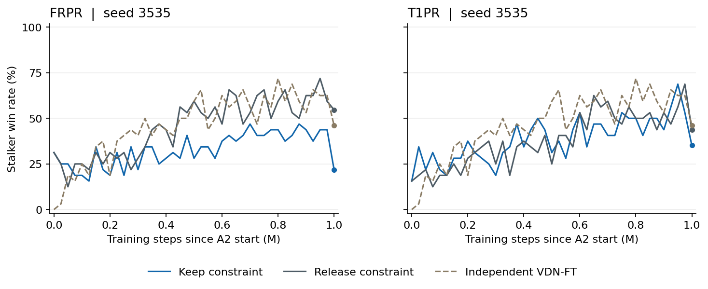

# TS4 双层 VDN64 · 回访约束消融

[实验结果索引](../../README.md) · [运行清单](runs.csv) · [生效配置](configs/) · [数据说明](../../DATA.md)

比较回到追猎者任务后继续或取消历史偏好约束，对回训速度和 B/C 保留的影响。双层 VDN 64，seed 3535，SMACv2 Protoss 镜像 5v5。追猎者 A₁ → 狂热者 B → 巨像 C → 追猎者 A₂，累计阈值 1M、1.5M、2M、3M，整局切换。每种方法各跑一次前三阶段，在 C 末分成 A₂ 继续约束和 A₂ 取消约束。两条前缀和四条分支均完成，合计新增 7,999,983 个训练环境步。两种方法分别运行了 A₁，A₁ 末模型权重逐位一致；每对 A₂ 分支的在线与目标模型恢复指纹与各自前缀匹配。

FRPR 对明确的合法动作对保持相对排序。T1PR 只约束置信度达标的首选动作。两法均用温度 1、归一化差阈值 0.5、旧 Q 标准差下限 0.1。继续组 A₂ 的权重为 1，回放 B/C 各四局；取消组权重为 0。六个前缀阶段历史池各收满 100 条胜局。累计 ε 衰减，TD replay 逐阶段重建。每个任务的阶段端点评估为 128 局，A₂ 开头及每 25k 步的当前任务评估为 32 局。

另有一条独立 VDN-FT 基线，从头训练 3,000,000 步。它使用相同任务、种子、网络结构、累计 ε、逐阶段重建 TD 回放和评估协议。三组独立训练的 A₁ 末 Agent 张量逐元素一致。基线运行于 `ce18b9e`，偏好分支运行于 `f623695`，继续和取消的配对效应由各方法自身的 C 末分叉估计。

## A₂ 学习曲线

横轴从各运行实际回访起点归零，圆点为 A₂ 末的 128 局评估。[A₂ 末逐任务结果图](return_endpoints.png)展示追猎者回训终点及狂热者、巨像的保留。

## 阶段矩阵

胜率和 ACC 单位为 %，BWT、FWT 单位为百分点。C 末的追猎者胜率是回访前的共同参考。旧任务均值为 B/C 等权平均。

| 方法 | 阶段 | 追猎者 | 狂热者 | 巨像 | ACC | BWT | FWT |
| --- | --- | ---: | ---: | ---: | ---: | ---: | ---: |
| FRPR | A₁ 末 | 25.00 | — | — | 25.00 | — | — |
| FRPR | B 末 | 24.22 | 65.63 | — | 44.92 | −0.78 | +18.75 |
| FRPR | C 末 | 25.78 | 59.38 | 42.19 | 42.45 | −2.73 | +24.22 |
| FRPR | A₂ 继续 | 21.88 | 58.59 | 37.50 | 39.32 | −5.86 | +24.22 |
| FRPR | A₂ 取消 | 54.69 | 41.41 | 27.34 | 41.15 | −19.53 | +24.22 |
| T1PR | A₁ 末 | 25.00 | — | — | 25.00 | — | — |
| T1PR | B 末 | 17.97 | 65.63 | — | 41.80 | −7.03 | +18.75 |
| T1PR | C 末 | 17.19 | 71.09 | 43.75 | 44.01 | −1.17 | +28.52 |
| T1PR | A₂ 继续 | 35.16 | 71.09 | 51.56 | 52.60 | +6.64 | +28.52 |
| T1PR | A₂ 取消 | 43.75 | 50.78 | 24.22 | 39.58 | −17.19 | +28.52 |
| VDN-FT | A₁ 末 | 25.00 | — | — | 25.00 | — | — |
| VDN-FT | B 末 | 17.19 | 66.41 | — | 41.80 | −7.81 | +18.75 |
| VDN-FT | C 末 | 0.00 | 0.00 | 52.34 | 17.45 | −45.70 | +26.17 |
| VDN-FT | A₂ 末 | 46.09 | 28.12 | 38.28 | 37.50 | −26.17 | +26.17 |

## 继续相对取消的配对差值

A₂ AUC 按 41 个追猎者评价点和实际训练步数做梯形积分，再除以 A₂ 实际步数。差值均为百分点。

| 方法 | A₂ 追猎者 AUC | A₂ 末追猎者 | A₂ 末狂热者 | A₂ 末巨像 | A₂ 末旧任务均值 | 最终 ACC |
| --- | ---: | ---: | ---: | ---: | ---: | ---: |
| FRPR | −12.36 | −32.81 | +17.19 | +10.16 | +13.67 | −1.82 |
| T1PR | +0.21 | −8.59 | +20.31 | +27.34 | +23.83 | +13.02 |

FRPR 继续组的追猎者回训 AUC 从取消组的 45.45% 降至 33.09%，保留收益未抵消追猎者终点的差距。T1PR 继续组和取消组的回训 AUC 分别为 38.84% 和 38.63%，继续组终点追猎者较低，但 B/C 的收益使最终 ACC 从 39.58% 升至 52.60%。首次追猎者 A₁ 末到回访前，FRPR 变化 +0.78 个百分点，T1PR 变化 −7.81 个百分点。两种方法在 B/C 使用不同约束，C 末状态不同，跨方法分支结果包含此前训练差异。

A₂ 继续组逐更新统计中，FRPR 在 B/C 采样决策上的约束覆盖率分别为 98.32%／99.50%，T1PR 为 60.63%／33.17%。这是对各自历史池和筛选条件的描述，无法单独归因回训差异。取消组也继承了 B/C 的方法训练历史。独立 VDN-FT 基线的 A₂ AUC 为 46.67%，回访前的 C 末状态与偏好分支不同。本次配对证据限于 seed 3535。

## 下载数据

- [逐次独立评估](evaluations.csv)包含 7 个运行的评估点。A₂ 分支的 A₁/B/C 评估由其父运行提供。
- [阶段指标与回训 AUC](stage_metrics.csv)由胜局数和局数重算。
- [偏好回放诊断](preference_diagnostics.csv)按历史任务给出每个阶段的约束计数与覆盖率。
- [运行清单](runs.csv)记录父运行、实际新增步数、训练 commit 及配置。分支的配置快照包含 C 末恢复信息和实际偏好权重。实验协议与实现见[偏好回放说明](../../../VDN_ACTION_SET_PREFERENCE.md)。
